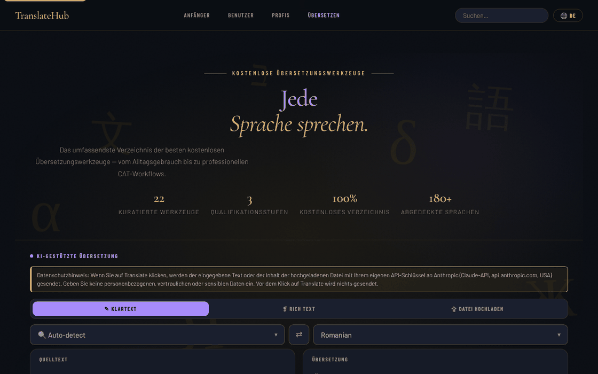

# TranslateHub

[English](README.md) · [Română](README.ro.md) · [Français](README.fr.md) · [Italiano](README.it.md) · [Español](README.es.md) · [Português](README.pt.md) · **Deutsch** · [Magyar](README.hu.md)

**Version:** 1.3.7 · **Zuletzt aktualisiert:** 2026-10-22

Oberflächensprachen: **Română, English, Français, Italiano, Español, Português (PT), Deutsch, Magyar**

Ein Verzeichnis kostenloser Übersetzungswerkzeuge, mit integriertem KI-Übersetzer (Claude), in einer einzigen HTML-Datei.

**Online:** https://chiuta.github.io/TranslateHub/

## Was es ist

TranslateHub ist eine einzelne Seite (`index.html`), die zwei Dinge verbindet:

- ein kuratiertes Verzeichnis von 22 kostenlosen Übersetzungs- und Linguistikwerkzeugen (Google Translate, DeepL, Linguee, WordReference, MateCat, OmegaT, LibreTranslate usw.), gruppiert auf drei Stufen: *Beginners*, *Average* und *Professionals*;
- einen KI-Übersetzer, der die Anthropic-API (Claude) nutzt, mit dem vom Nutzer bereitgestellten API-Schlüssel.

## Funktionen

- Verzeichnis mit Karten für jedes Werkzeug (Beschreibung, Merkmale, ungefähre Anzahl der Sprachen, Schaltfläche „Open ↗"), mit Suche („Search translation tools") und Navigationslinks nach Stufen.
- Schnellfilter (Chips) unter dem Übersetzerbereich, aus den Etiketten der Karten erzeugt (z. B. „Open source", „API"); Kürzel: `/` setzt den Fokus auf die Suche, `Esc` leert sie.
- Drei KI-Übersetzungsmodi: **Plain Text**, **Rich Text** (Formatierungsleiste B / I / U / H1–H3 / Listen / Tabelle; `.html`-Export) und **File Upload**.
- Datei-Upload (max. 2 MB): `.txt`, `.md`, `.html`, `.docx`, `.srt`, `.po`, `.csv`, `.json`; Vorschau und Download der übersetzten Datei.
- Wahl der Ausgangssprache (mit „Auto-detect") und der Zielsprache, Tauschschaltfläche (⇄; mit „Auto-detect" nutzt sie die bei der letzten Übersetzung erkannte Sprache, was die Prüfung durch Rückübersetzung ermöglicht), Suche in der Sprachliste.
- Zeichen- und Wortzähler, Schaltflächen „Clear", „Copy", „↓ .txt".
- Schaltfläche „Cancel" für eine laufende Übersetzung.
- Oberflächensprache: Auswahl „EN" in der oberen Leiste. Eingebaute Übersetzungen für 20 Sprachen (en, ro, fr, es, de, it, pt, ru, zh-Hans, ja, ar, ko, tr, pl, nl, sv, cs, hu, el, hi); für andere Sprachen wird die Oberfläche über die Claude-API übersetzt und lokal zwischengespeichert. Die Texte der Prüfung auf personenbezogene Daten, der Anzeige „was geht raus“ und des Verlaufs gibt es in 8 Sprachen (ro, en, fr, it, es, pt, de, hu); in den übrigen 12 eingebauten Sprachen erscheinen sie auf Englisch.
- Rechtliche/Datenschutz-Abschnitte in der Anwendung (DSGVO, Speicherung im Browser, Übermittlung an Dritte).

## Neue Funktionen (1.1.0)

- **Lokale Prüfung auf personenbezogene Daten vor „Translate"** (`FFF.pii`), in allen drei Modi (einfacher Text, formatierter Text, Datei): Enthält der Text E-Mail-Adressen, Telefonnummern, IBAN, CNP, Karten, IPs oder Schlüssel, geht nichts an `api.anthropic.com`, bis du „Markierte maskieren und fortfahren", „Ohne Maskierung fortfahren" oder „Abbrechen" wählst. Funktioniert auch mit Strg+Enter. Sie lässt sich abschalten (die Einstellung bleibt erhalten).
- **Anzeige „was geht raus":** „↗ Bei „Translate" geht der Text an api.anthropic.com", mit Erklärung (dein Schlüssel, nur im Tab gehalten). Das Werkzeugverzeichnis und die Suche laufen lokal.
- **Optionaler lokaler Übersetzungsverlauf (standardmäßig aus):** nur echte, von der API erhaltene Ergebnisse; Panel „🗂 Übersetzungsverlauf" mit lokaler semantischer Suche (`FFF.search`), Wiederverwendung des Ausgangstextes, Kopieren, Markdown-Export, Löschen, Scannen/Maskieren personenbezogener Daten im Verlauf.
- **Verschlüsselte Sicherung** über das Transparenzlabel (`FFF.bundle`). Der API-Schlüssel bleibt in `sessionStorage` und gelangt **nicht** in die Sicherung.

### Grenzen
- Die Erkennung personenbezogener Daten ist heuristisch und kann etwas übersehen; die Maskierung ersetzt Werte durch Platzhalter, was die Übersetzung verändern kann.
- Im Modus „formatierter Text" wird die Maskierung auf Textknoten angewendet; die Formatierung bleibt erhalten.
- Der Verlauf hat eine Obergrenze (200 Einträge / ~1,5 Mio. Zeichen).

**FFF-Kit.** Aus `fff-kit` (in `index.html` eingefügt, ohne Netzwerk) werden die Module `core, label, bundle, pii, search` verwendet: Transparenzlabel (Version im Fußbereich drücken), `.fff.json`-Export/-Import/-Löschen mit optionaler AES-GCM- + PBKDF2-Verschlüsselung, lokale Erkennung personenbezogener Daten und lokale BM25-Suche. Die CSP-Richtlinie **wurde gegenüber der Vorversion nicht verändert**, außer bei den `sha256`-Hashes der Inline-Skripte (die neuen Stile stehen in `<style>`, abgedeckt durch das bereits vorhandene `style-src 'unsafe-inline'`; es wurde kein neuer Host hinzugefügt). Die Übersetzungen der neuen Texte ins Fr/It/Es/Pt/Hu/De sind maschinell und **nicht von Muttersprachlern geprüft**. Die Erkennung personenbezogener Daten ist heuristisch: Sie kann etwas übersehen oder fälschlich melden; sie ersetzt nicht deine eigene Prüfung.

## Bedienungsanleitung

1. Öffne die Seite. Gib für die KI-Übersetzung im Banner „API key required" den Anthropic-Schlüssel in das Feld „Anthropic API key" ein und drücke „Save key". „Clear" löscht ihn; „Get key ↗" öffnet die Seite zum Beschaffen des Schlüssels.
2. Wähle den Modus: „✎ Plain Text", „❡ Rich Text" oder „⇪ File Upload".
3. Wähle die Ausgangssprache (oder „Auto-detect") und die Zielsprache; ⇄ vertauscht sie.
4. Schreibe/füge den Text ein (oder ziehe die Datei in den Bereich „Drop your file here" / klicke, um sie auszuwählen).
5. Drücke die Schaltfläche **Translate** oder `Strg+Enter` (`Cmd+Enter` unter macOS) im Textfeld.
6. Kopiere das Ergebnis („⧉ Copy"), lade es herunter („↓ .txt", „↓ .html" oder „↓ Download translated file").
7. Um die Oberflächensprache zu ändern, drücke die Sprachschaltfläche in der oberen Leiste und wähle die Sprache; die Wahl wird gemerkt.
8. Für das Werkzeugverzeichnis scrolle zu „Beginners", „Average users" oder „Professionals" oder nutze die Suche; „Open ↗" öffnet die Website des Werkzeugs in einem neuen Tab.

## Datenschutz und Netzwerk

- **Lokaler Speicher:** `localStorage` — der Code der Oberflächensprache (`ui_lang_pref`, `ui_lang_name`) und die zwischengespeicherten Oberflächenübersetzungen (`ui_<Code>`). `sessionStorage` — der Anthropic-API-Schlüssel (`th_apikey`), beim Schließen des Tabs gelöscht; ebenfalls im `sessionStorage` wird vorübergehend die Übersetzung der rechtlichen/DSGVO-Abschnitte gehalten, wenn du sie über die API anforderst. Die Anwendung setzt keine Cookies.
- **Netzwerk:** Die Anwendung kontaktiert `https://api.anthropic.com/v1/messages` **nur**, wenn du die KI-Übersetzung nutzt oder eine Oberflächensprache ohne eingebaute Übersetzung wählst. Der eingegebene Text (oder der Dateiinhalt) und dein Schlüssel werden an Anthropic gesendet; die Richtlinie der Anwendung erwähnt die Aufbewahrung der Daten durch Anthropic bis zu 30 Tage. Die Sicherheitsrichtlinie der Seite (CSP) erlaubt Verbindungen nur zu diesem Host (`connect-src https://api.anthropic.com`, `img-src 'self' data:`); `script-src` erlaubt nur das eigene Skript, identifiziert durch einen SHA-256-Hash, ohne Inline-Handler.
- **Sichtbarer Hinweis vor dem KI-Modus:** Über der Modusauswahl zeigt das Übersetzungspanel einen Hinweis (EN, RO, FR, ES, DE, IT, PT, HU; die übrigen Sprachen erhalten ihn auf Englisch), dass Text oder Datei mit dem Schlüssel des Nutzers an Anthropic (USA) gesendet werden, dass keine personenbezogenen/sensiblen Daten eingegeben werden sollen und dass vor „Translate" nichts gesendet wird. Der DSGVO-Text der Anwendung wurde angeglichen (er behauptet nicht mehr, die Anwendung „verarbeite keine personenbezogenen Daten").
- Die Schriften sind in die Datei eingebettet; der `.docx`-Parser (mammoth.js) ist lokal in `vendor/` enthalten.
- Die Links im Verzeichnis zu den Websites der Werkzeuge sind einfache Verweise; an sie wird keine Anfrage gestellt, bis du sie öffnest.
- Keine Analytics und keine Werbung (laut Hinweis in der Anwendung).

## Lokale Ausführung / offline

Lade `index.html` (und für `.docx`-Dateien den Ordner `vendor/`) herunter und öffne sie im Browser. Das Werkzeugverzeichnis und die Oberfläche in den 20 eingebauten Sprachen funktionieren ohne Internet; die KI-Übersetzung benötigt eine Internetverbindung und einen Anthropic-API-Schlüssel.

## Verlauf / Changelog

### 1.3.7 — 2026-10-22
- fff-kit 1.1.4: Touch-Ziele und Mindestschriftgröße; Touch-Ziele/Text korrigiert

### 1.3.6 — 2026-10-22
- Barrierefreiheit: deutlicher Fokusring am Quelltext-Feld, an den Sprachauswahlen und an den übrigen Eingabefeldern (Kontrast von mindestens 3:1).

### 1.3.5 — 2026-10-22
- fff-kit 1.1.2: PBKDF2 mit 600.000 Iterationen, Schutz vor Clickjacking.

### 1.3.4 — 2026-10-22
- Kein API-Schlüssel, keine Anfrage: „Übersetzen“ ohne Schlüssel ruft api.anthropic.com nicht mehr auf (kein Preflight, keine Wiederholungen) und zeigt sofort die Schlüsselleiste samt Hinweis.
- Einwilligung beim ersten Senden: Ein Dialog erklärt, dass der Text mit deinem eigenen Schlüssel an api.anthropic.com geht; vor der Bestätigung wird nichts gesendet.
- Optionales, geprüftes Modellfeld neben dem Schlüssel; alert()/confirm() bei großen Texten wurden durch Dialoge und Hinweise in der Seite ersetzt.
- Mobil: kein Text unter 12 px und Touch-Ziele von mindestens 24 px (WCAG 2.5.8).

### 1.3.3 — 2026-10-22
- Die Sprachnamen in der Auswahl der Oberflächensprache sind jetzt lokalisiert (Exonyme in der aktuellen Sprache, auch über englischen Namen und Endonym durchsuchbar); die beiden verbliebenen Überschriften (IATE, Glossar- und TM-Ressourcen), das aria-label „Rechtliche Abschnitte“ und der Hinweis Strg+Eingabe sind übersetzt. Auf Anfrage erzeugte Rechtstexte bleiben, wie die API sie liefert.

### 1.3.2 — 2026-10-22
- Übersetzungskorrekturen: Seitentitel und Meta-Tags folgen der Oberflächensprache; Meldungen, Hinweise, Fortschrittstext, Sprachnamen, Tags und das API-Schlüssel-Banner sind übersetzt; der Zeichenzähler verschwindet beim Sprachwechsel nicht mehr. Rechtstexte und Produktnamen bleiben bewusst englisch.

### 19. Oktober 2026 — Version 1.3.1
- Die Prüfung auf personenbezogene Daten vor „Translate“, die Anzeige „was geht raus“ und der optionale lokale Verlauf (siehe 1.1.0) sind in der aktuellen Version vorhanden: Sie waren bei einer früheren Bereinigung versehentlich entfernt worden und wurden (1.3.0) mit demselben Verhalten und neuen Tests neu implementiert. Die Beschreibungen der Werkzeugkarten und die Hinweis-/Bestätigungsmeldungen sind in die 8 Sprachen (ro, en, fr, it, es, pt, de, hu) übersetzt.

### 14. Oktober 2026 — Version 1.1.0
- Lokale Prüfung auf personenbezogene Daten vor dem Senden, Anzeige „was geht raus", optionaler durchsuchbarer lokaler Verlauf, verschlüsselte `.fff.json`-Sicherung, Transparenzlabel; Tests in `tests/fff-r8.test.mjs`.

### 12. Oktober 2026 — Version 1.0.0
- 1.0.0 — 2026-10-12: Version und Datum der letzten Aktualisierung werden in der App angezeigt

### 11. Oktober 2026 (dritter Durchgang)
- Die Schaltfläche ⇄ funktioniert auch mit der Quelle „Auto-detect": Sie nutzt die bei der letzten Übersetzung erkannte Sprache (das Badge „Detected: …"), sodass die Rückübersetzung zur Prüfung ein einziger Klick ist; andernfalls erklärt die Meldung, was zu tun ist. Mit einer simulierten API-Antwort geprüft (ohne Netzwerk). CSP: Hash neu berechnet.

### 11. Oktober 2026 (zweiter Durchgang)
- Verzeichnis: Schnellfilter nach Etiketten (automatisch aus den Karten erzeugt, keine neuen Daten) und Tastenkürzel für die Suche (`/`, `Esc`); die Schaltfläche Translate zeigt `Ctrl+Enter` als Titel. CSP: Skript-Hash neu berechnet.

### 11. Oktober 2026
- Barrierefreiheit: Der Seiteninhalt (einschließlich des Übersetzerbereichs) ist jetzt in `<main>` eingefasst, und das Unterstützungs-Widget hat eine Landmark-Rolle; axe-core meldet 0 Verstöße bei 1280 und 360 px.
- Sicherheit: Die Inline-`onclick`-Handler wurden durch einen delegierten Handler ersetzt, und die CSP erlaubt nur das eigene Skript per SHA-256-Hash (ohne `'unsafe-inline'` in `script-src`).
- Ohne API-Schlüssel wird der Fehler „Failed to fetch" durch eine ausdrückliche Meldung ersetzt, und das Banner „API key required" wird angezeigt und erhält den Fokus.
- Das Label „100% Free to use" wurde zu „Free directory" (in allen 20 Sprachen): Das Verzeichnis ist kostenlos, aber die KI-Übersetzung nutzt den eigenen API-Schlüssel, den der Nutzer bezahlt.
- Daten aktualisiert: Google Translate 249 Sprachen, DeepL 120 Sprachen; DeepL-Grenze „3 Dokumente/Monat" entfernt (konnte nicht bestätigt werden). Die „Last updated"-Texte in den rechtlichen Abschnitten: Oktober 2026.

**Am 11.10.2026 geprüfte Quellen:** Wikipedia — Google Translate (249 Sprachen, September 2026); Wikipedia — DeepL Translator (120 Sprachen, Juli 2026).

## Lizenz

MIT — siehe Datei LICENSE

## Audit

Audit: 2026-10-10 (überarbeitet 2026-10-11) — die Beschreibungen im README entsprechen dem Code (der einzige kontaktierte Host: `api.anthropic.com`, nur bei der KI-Übersetzung / bei der Übersetzung der Oberfläche in Sprachen ohne eingebaute Übersetzung). Kleinere Barrierefreiheitskorrekturen (Kontrast, Fokus). Die maschinelle Übersetzung kann Fehler enthalten; verwende sie für amtliche Dokumente oder solche mit sensiblen personenbezogenen Daten nicht ohne Prüfung.

## Autor

Alexio — Alexandru-Ionuț Chiuță. Kontakt: alexio@trom.tf

## Zusammenfassung

TranslateHub ist eine HTML-Seite in einer einzigen Datei mit einem kuratierten Verzeichnis von 22 kostenlosen Übersetzungswerkzeugen plus einem KI-Übersetzer (einfacher Text, formatierter Text, Datei-Upload für 8 Formate), der die Anthropic-API mit dem eigenen, in sessionStorage gehaltenen Schlüssel des Nutzers aufruft. Die Oberfläche wird mit 20 eingebauten Sprachen ausgeliefert. Der einzige kontaktierte Host ist api.anthropic.com, und nur, wenn KI-Funktionen genutzt werden. MIT-Lizenz.
