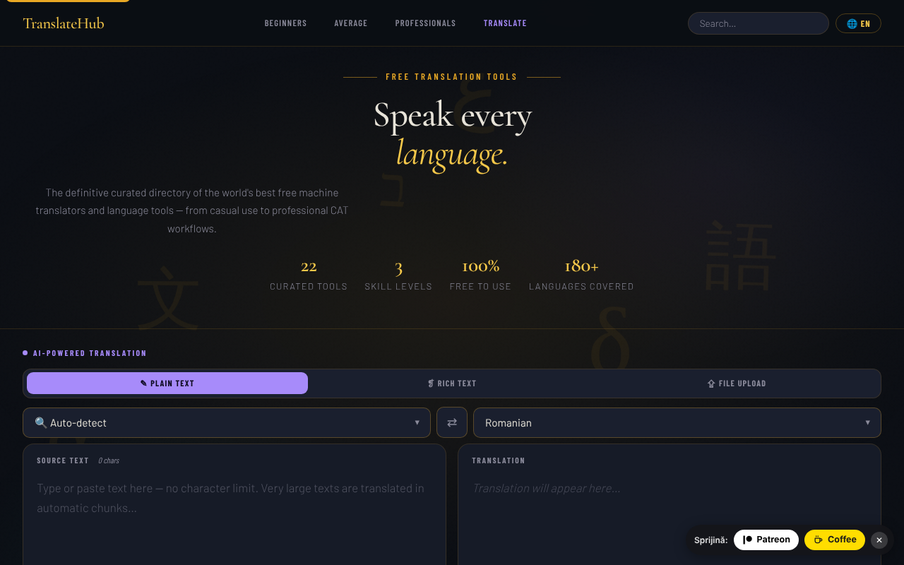

# TranslateHub

[English](README.md) · [Română](README.ro.md) · [Français](README.fr.md) · [Italiano](README.it.md) · **Español** · [Português](README.pt.md) · [Deutsch](README.de.md) · [Magyar](README.hu.md)

**Versión:** 1.2.0 · **Última actualización:** 2026-10-19

Idiomas de la interfaz: **Română, English, Français, Italiano, Español, Português (PT), Deutsch, Magyar**

Un directorio de herramientas de traducción gratuitas, con un traductor de IA integrado (Claude), en un único archivo HTML.

**En línea:** https://chiuta.github.io/TranslateHub/

## Qué es

TranslateHub es una página única (`index.html`) que combina dos cosas:

- un directorio seleccionado de 22 herramientas gratuitas de traducción y lingüística (Google Translate, DeepL, Linguee, WordReference, MateCat, OmegaT, LibreTranslate, etc.), agrupadas en tres niveles: *Beginners*, *Average* y *Professionals*;
- un traductor de IA que usa la API de Anthropic (Claude), con la clave API aportada por el usuario.

## Funciones

- Directorio con fichas de cada herramienta (descripción, características, número aproximado de idiomas, botón «Open ↗»), con búsqueda («Search translation tools») y enlaces de navegación por niveles.
- Filtros rápidos (chips) bajo la zona del traductor, generados a partir de las etiquetas de las fichas (p. ej. «Open source», «API»); atajos: `/` mueve el foco a la búsqueda, `Esc` la vacía.
- Tres modos de traducción con IA: **Plain Text**, **Rich Text** (barra de formato B / I / U / H1–H3 / listas / tabla; exportación `.html`) y **File Upload**.
- Subida de archivos (máx. 2 MB): `.txt`, `.md`, `.html`, `.docx`, `.srt`, `.po`, `.csv`, `.json`; vista previa y descarga del archivo traducido.
- Elección del idioma de origen (con «Auto-detect») y del idioma de destino, botón de intercambio (⇄; con «Auto-detect» usa el idioma detectado en la última traducción, lo que permite la verificación mediante retrotraducción), búsqueda en la lista de idiomas.
- Contador de caracteres y palabras, botones «Clear», «Copy», «↓ .txt».
- Botón «Cancel» para una traducción en curso.
- Idioma de la interfaz: selector «EN» en la barra superior. Traducciones integradas para 20 idiomas (en, ro, fr, es, de, it, pt, ru, zh-Hans, ja, ar, ko, tr, pl, nl, sv, cs, hu, el, hi); para otros idiomas la interfaz se traduce mediante la API de Claude y se guarda en caché local.
- Secciones jurídicas/de privacidad en la aplicación (RGPD, almacenamiento en el navegador, transferencias a terceros).

## Novedades (1.1.0)

- **Comprobación local de datos personales antes de «Translate»** (`FFF.pii`), en los tres modos (texto simple, texto con formato, archivo): si el texto contiene correos electrónicos, teléfonos, IBAN, CNP, tarjetas, IP o claves, no sale nada hacia `api.anthropic.com` hasta que elijas «Enmascarar lo marcado y continuar», «Continuar sin enmascarar» o «Cancelar». Funciona también con Ctrl+Intro. Se puede desactivar (la preferencia se conserva).
- **Indicador «qué sale»:** «↗ Al pulsar «Translate», el texto sale hacia api.anthropic.com», con una explicación (tu clave, guardada solo en la pestaña). El directorio de herramientas y la búsqueda se ejecutan en local.
- **Historial local de traducciones, opcional (desactivado por defecto):** solo resultados reales recibidos de la API; panel «🗂 Historial de traducciones» con búsqueda semántica local (`FFF.search`), reutilización del texto de origen, copia, exportación a Markdown, borrado, análisis/enmascaramiento de datos personales en el historial.
- **Copia cifrada** mediante la etiqueta de transparencia (`FFF.bundle`). La clave API permanece en `sessionStorage` y **no** entra en la copia.

### Límites
- La detección de datos personales es heurística y puede pasar por alto algo; el enmascaramiento sustituye los valores por etiquetas, lo que puede cambiar la traducción.
- En el modo «texto con formato» el enmascaramiento se aplica a los nodos de texto; el formato se conserva.
- El historial tiene un tope (200 entradas / ~1,5 M de caracteres).

**Kit FFF.** De `fff-kit` (incorporado en `index.html`, sin red) se usan los módulos `core, label, bundle, pii, search`: etiqueta de transparencia (pulsa la versión en el pie de página), exportación/importación/borrado `.fff.json` con cifrado opcional AES-GCM + PBKDF2, detección local de datos personales y búsqueda local BM25. La política CSP **no se ha cambiado** respecto a la versión anterior, salvo los hashes `sha256` de los scripts en línea (los estilos nuevos están en `<style>`, cubierto por el `style-src 'unsafe-inline'` ya presente; no se ha añadido ningún host nuevo). Las traducciones de los textos nuevos al fr/it/es/pt/hu/de son automáticas y **no están verificadas por hablantes nativos**. La detección de datos personales es heurística: puede fallar o señalar por error; no sustituye tu propia comprobación.

## Guía de uso

1. Abre la página. Para la traducción con IA, en el banner «API key required» introduce la clave de Anthropic en el campo «Anthropic API key» y pulsa «Save key». «Clear» la borra; «Get key ↗» abre la página para obtener la clave.
2. Elige el modo: «✎ Plain Text», «❡ Rich Text» o «⇪ File Upload».
3. Elige el idioma de origen (o «Auto-detect») y el idioma de destino; ⇄ los intercambia.
4. Escribe/pega el texto (o arrastra el archivo a la zona «Drop your file here» / haz clic para elegirlo).
5. Pulsa el botón **Translate** o `Ctrl+Intro` (`Cmd+Intro` en macOS) en el campo de texto.
6. Copia el resultado («⧉ Copy»), descárgalo («↓ .txt», «↓ .html» o «↓ Download translated file»).
7. Para cambiar el idioma de la interfaz, pulsa el botón de idioma de la barra superior y elige el idioma; la elección se recuerda.
8. Para el directorio de herramientas, desplázate hasta «Beginners», «Average users» o «Professionals» o usa la búsqueda; «Open ↗» abre el sitio de la herramienta en una pestaña nueva.

## Privacidad y red

- **Almacenamiento local:** `localStorage` — el código del idioma de la interfaz (`ui_lang_pref`, `ui_lang_name`) y las traducciones de la interfaz en caché (`ui_<código>`). `sessionStorage` — la clave API de Anthropic (`th_apikey`), borrada al cerrar la pestaña; también se guarda temporalmente en `sessionStorage` la traducción de las secciones jurídicas/RGPD, si la solicitas mediante la API. La aplicación no establece cookies.
- **Red:** la aplicación contacta con `https://api.anthropic.com/v1/messages` **solo** cuando usas la traducción con IA o cuando eliges un idioma de interfaz sin traducción integrada. El texto introducido (o el contenido del archivo) y tu clave se envían a Anthropic; la política de la aplicación menciona la conservación de datos por parte de Anthropic hasta 30 días. La política de seguridad de la página (CSP) permite conexiones solo a este host (`connect-src https://api.anthropic.com`, `img-src 'self' data:`); `script-src` permite solo el script propio, identificado por un hash SHA-256, sin manejadores en línea.
- **Advertencia visible antes del modo IA:** sobre el selector de modos, el panel de traducción muestra una nota (EN, RO, FR, ES, DE, IT, PT; los demás idiomas la reciben en inglés) que indica que el texto o el archivo se envían a Anthropic (EE. UU.), con la clave del usuario, que no deben introducirse datos personales/sensibles y que no se envía nada antes de «Translate». El texto del RGPD de la aplicación se ha alineado (ya no afirma que la aplicación «no trata datos personales»).
- Las fuentes están incorporadas en el archivo; el analizador de `.docx` (mammoth.js) se incluye en local en `vendor/`.
- Los enlaces del directorio a los sitios de las herramientas son enlaces simples; no se hace ninguna solicitud hacia ellos hasta que los abres.
- Sin analítica y sin publicidad (según la nota de la aplicación).

## Ejecución local / sin conexión

Descarga `index.html` (y, para archivos `.docx`, la carpeta `vendor/`) y ábrelo en un navegador. El directorio de herramientas y la interfaz en los 20 idiomas integrados funcionan sin internet; la traducción con IA requiere conexión a internet y una clave API de Anthropic.

## Historial / Changelog

### 14 de octubre de 2026 — versión 1.1.0
- Comprobación local de datos personales antes del envío, indicador «qué sale», historial local opcional con búsqueda, copia cifrada `.fff.json`, etiqueta de transparencia; pruebas en `tests/fff-r8.test.mjs`.

### 12 de octubre de 2026 — versión 1.0.0
- 1.0.0 — 2026-10-12: la versión y la fecha de la última actualización se muestran en la aplicación

### 11 de octubre de 2026 (tercera pasada)
- El botón ⇄ funciona también con el origen «Auto-detect»: usa el idioma detectado en la última traducción (la insignia «Detected: …»), de modo que la retrotraducción de verificación es un solo clic; de lo contrario el mensaje explica qué hacer. Verificado con una respuesta de API simulada (sin red). CSP: hash recalculado.

### 11 de octubre de 2026 (segunda pasada)
- Directorio: filtros rápidos por etiquetas (generados automáticamente a partir de las fichas, sin datos nuevos) y atajos de teclado para la búsqueda (`/`, `Esc`); el botón Translate muestra `Ctrl+Enter` como título. CSP: hash del script recalculado.

### 11 de octubre de 2026
- Accesibilidad: el contenido de la página (incluida la zona del traductor) está ahora envuelto en `<main>`, y el widget de apoyo tiene rol de punto de referencia; axe-core informa de 0 infracciones a 1280 y 360 px.
- Seguridad: los manejadores `onclick` en línea se sustituyeron por un manejador delegado, y la CSP permite solo el script propio mediante hash SHA-256 (sin `'unsafe-inline'` en `script-src`).
- Sin clave API, el error «Failed to fetch» se sustituye por un mensaje explícito, y el banner «API key required» se muestra y recibe el foco.
- La etiqueta «100% Free to use» pasó a ser «Free directory» (en los 20 idiomas): el directorio es gratuito, pero la traducción con IA usa la clave API propia, pagada por el usuario.
- Datos actualizados: Google Translate 249 idiomas, DeepL 120 idiomas; se eliminó el límite de DeepL de «3 documentos/mes» (no pudo confirmarse). Los textos «Last updated» de las secciones jurídicas: octubre de 2026.

**Fuentes verificadas el 11.10.2026:** Wikipedia — Google Translate (249 idiomas, septiembre de 2026); Wikipedia — DeepL Translator (120 idiomas, julio de 2026).

## Licencia

MIT — véase el archivo LICENSE

## Auditoría

Auditoría: 2026-10-10 (revisada 2026-10-11) — las descripciones del README corresponden al código (el único host contactado: `api.anthropic.com`, solo para la traducción con IA / para la traducción de la interfaz en idiomas sin traducción integrada). Correcciones menores de accesibilidad (contraste, foco). La traducción automática puede contener errores; no la uses sin comprobarla para documentos oficiales o con datos personales sensibles.

## Autor

Alexio — Alexandru-Ionuț Chiuță. Contacto: alexio@trom.tf

## Resumen

TranslateHub es una página HTML de un solo archivo con un directorio seleccionado de 22 herramientas de traducción gratuitas más un traductor de IA (texto simple, texto con formato, subida de archivos en 8 formatos) que llama a la API de Anthropic con la clave propia del usuario, guardada en sessionStorage. La interfaz se entrega con 20 idiomas integrados. El único host contactado es api.anthropic.com, y solo cuando se usan las funciones de IA. Licencia MIT.
