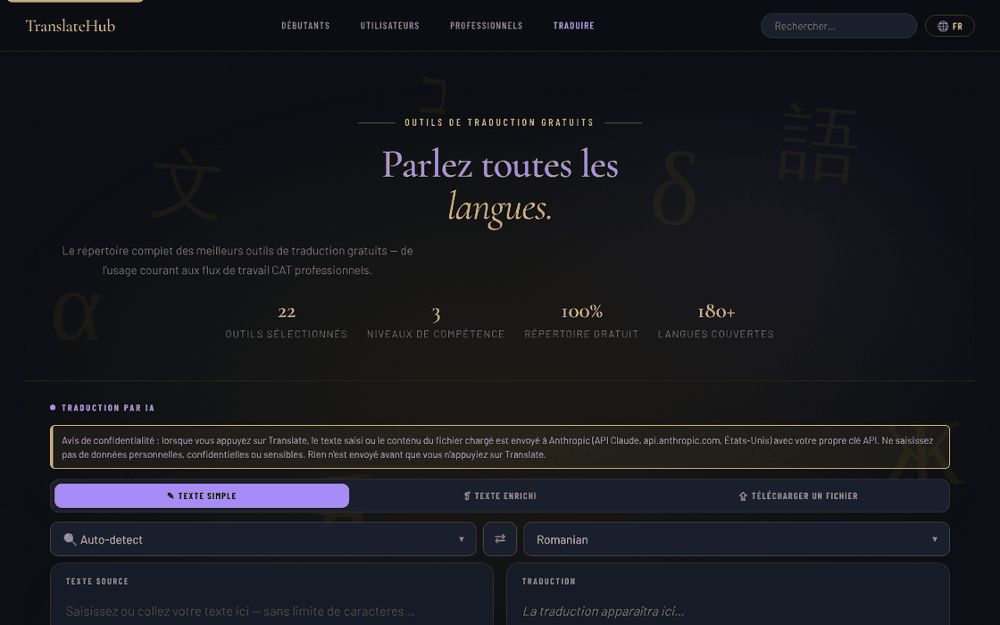

# TranslateHub

[English](README.md) · [Română](README.ro.md) · **Français** · [Italiano](README.it.md) · [Español](README.es.md) · [Português](README.pt.md) · [Deutsch](README.de.md) · [Magyar](README.hu.md)

**Version :** 1.3.11 · **Dernière mise à jour :** 2026-10-26

Langues de l'interface : **Română, English, Français, Italiano, Español, Português (PT), Deutsch, Magyar**

Un annuaire d'outils de traduction gratuits, avec un traducteur IA intégré (Claude), dans un seul fichier HTML.

**En ligne :** https://chiuta.github.io/TranslateHub/

## De quoi s'agit-il

TranslateHub est une page unique (`index.html`) qui réunit deux choses :

- un annuaire sélectionné de 22 outils gratuits de traduction et de linguistique (Google Translate, DeepL, Linguee, WordReference, MateCat, OmegaT, LibreTranslate, etc.), regroupés en trois niveaux : *Beginners*, *Average* et *Professionals* ;
- un traducteur IA qui utilise l'API d'Anthropic (Claude), avec la clé API fournie par l'utilisateur.

## Fonctionnalités

- Annuaire avec des fiches pour chaque outil (description, caractéristiques, nombre approximatif de langues, bouton « Open ↗ »), avec recherche (« Search translation tools ») et liens de navigation par niveau.
- Filtres rapides (chips) sous la zone du traducteur, générés à partir des étiquettes des fiches (p. ex. « Open source », « API ») ; raccourcis : `/` place le focus sur la recherche, `Esc` la vide.
- Trois modes de traduction par IA : **Plain Text**, **Rich Text** (barre de mise en forme B / I / U / H1–H3 / listes / tableau ; export `.html`) et **File Upload**.
- Téléversement de fichiers (max. 2 Mo) : `.txt`, `.md`, `.html`, `.docx`, `.srt`, `.po`, `.csv`, `.json` ; aperçu et téléchargement du fichier traduit.
- Choix de la langue source (avec « Auto-detect ») et de la langue cible, bouton d'inversion (⇄ ; avec « Auto-detect », il utilise la langue détectée lors de la dernière traduction, ce qui permet la vérification par rétro-traduction), recherche dans la liste des langues.
- Compteur de caractères et de mots, boutons « Clear », « Copy », « ↓ .txt ».
- Bouton « Cancel » pour une traduction en cours.
- Langue de l'interface : sélecteur « EN » dans la barre du haut. Traductions intégrées pour 20 langues (en, ro, fr, es, de, it, pt, ru, zh-Hans, ja, ar, ko, tr, pl, nl, sv, cs, hu, el, hi) ; pour les autres langues, l'interface est traduite via l'API Claude et mise en cache localement. Les textes de la vérification des données personnelles, de l'indicateur « ce qui part » et de l'historique existent en 8 langues (ro, en, fr, it, es, pt, de, hu) ; dans les 12 autres langues intégrées, ils apparaissent en anglais.
- Sections juridiques/de confidentialité dans l'application (RGPD, stockage dans le navigateur, transferts à des tiers).

## Nouveautés (1.1.0)

- **Vérification locale des données personnelles avant « Translate »** (`FFF.pii`), dans les trois modes (texte simple, texte enrichi, fichier) : si le texte contient des e-mails, téléphones, IBAN, CNP, cartes, IP ou clés, rien ne part vers `api.anthropic.com` tant que vous n'avez pas choisi « Masquer les éléments cochés et continuer », « Continuer sans masquer » ou « Annuler ». Fonctionne aussi avec Ctrl+Entrée. Peut être désactivée (la préférence est conservée).
- **Indicateur « ce qui part » :** « ↗ Au clic sur « Translate », le texte part vers api.anthropic.com », avec une explication (votre clé, conservée uniquement dans l'onglet). L'annuaire d'outils et la recherche s'exécutent localement.
- **Historique local des traductions, facultatif (désactivé par défaut) :** uniquement des résultats réels reçus de l'API ; panneau « 🗂 Historique des traductions » avec recherche sémantique locale (`FFF.search`), reprise du texte source, copie, export Markdown, suppression, analyse/masquage des données personnelles dans l'historique.
- **Sauvegarde chiffrée** via l'étiquette de transparence (`FFF.bundle`). La clé API reste dans `sessionStorage` et **n'entre pas** dans la sauvegarde.

### Limites
- La détection des données personnelles est heuristique et peut passer à côté de certaines données ; le masquage remplace les valeurs par des étiquettes, ce qui peut modifier la traduction.
- En mode « texte enrichi », le masquage s'applique aux nœuds de texte ; la mise en forme est conservée.
- L'historique est plafonné (200 entrées / ~1,5 M de caractères).

**Kit FFF.** On utilise de `fff-kit` (intégré dans `index.html`, sans réseau) les modules `core, label, bundle, pii, search` : étiquette de transparence (appuyez sur la version dans le pied de page), export/import/suppression `.fff.json` avec chiffrement facultatif AES-GCM + PBKDF2, détection locale des données personnelles et recherche locale BM25. La politique CSP **n'a pas été modifiée** par rapport à la version précédente, hormis les empreintes `sha256` des scripts en ligne (les nouveaux styles sont dans `<style>`, couvert par le `style-src 'unsafe-inline'` déjà présent ; aucun nouvel hôte n'a été ajouté). Les traductions des nouveaux textes en fr/it/es/pt/hu/de sont automatiques et **non vérifiées par des locuteurs natifs**. La détection des données personnelles est heuristique : elle peut manquer des données ou en signaler à tort ; elle ne remplace pas votre propre vérification.

## Mode d'emploi

1. Ouvrez la page. Pour la traduction par IA, dans la bannière « API key required », saisissez la clé Anthropic dans le champ « Anthropic API key » et appuyez sur « Save key ». « Clear » l'efface ; « Get key ↗ » ouvre la page d'obtention de la clé.
2. Choisissez le mode : « ✎ Plain Text », « ❡ Rich Text » ou « ⇪ File Upload ».
3. Choisissez la langue source (ou « Auto-detect ») et la langue cible ; ⇄ les inverse.
4. Saisissez/collez le texte (ou faites glisser le fichier dans la zone « Drop your file here » / cliquez pour le choisir).
5. Appuyez sur le bouton **Translate** ou sur `Ctrl+Entrée` (`Cmd+Entrée` sur macOS) dans le champ de texte.
6. Copiez le résultat (« ⧉ Copy »), téléchargez-le (« ↓ .txt », « ↓ .html » ou « ↓ Download translated file »).
7. Pour changer la langue de l'interface, appuyez sur le bouton de langue dans la barre du haut et choisissez la langue ; le choix est mémorisé.
8. Pour l'annuaire d'outils, faites défiler jusqu'à « Beginners », « Average users » ou « Professionals », ou utilisez la recherche ; « Open ↗ » ouvre le site de l'outil dans un nouvel onglet.

## Confidentialité et réseau

- **Stockage local :** `localStorage` — le code de la langue de l'interface (`translatehub.ui_lang_pref`, `translatehub.ui_lang_name`) et les traductions de l'interface mises en cache (`translatehub.ui_<code>`). `sessionStorage` — la clé API Anthropic (`th_apikey`), effacée à la fermeture de l'onglet ; la traduction des sections juridiques/RGPD est aussi conservée temporairement dans `sessionStorage`, si vous la demandez via l'API. L'application ne dépose aucun cookie.
- **Réseau :** l'application contacte `https://api.anthropic.com/v1/messages` **uniquement** lorsque vous utilisez la traduction par IA ou lorsque vous choisissez une langue d'interface sans traduction intégrée. Le texte saisi (ou le contenu du fichier) et votre clé sont envoyés à Anthropic ; la politique de l'application mentionne la conservation des données par Anthropic jusqu'à 30 jours. La politique de sécurité de la page (CSP) n'autorise les connexions que vers cet hôte (`connect-src https://api.anthropic.com`, `img-src 'self' data:`) ; `script-src` n'autorise que le script propre à la page, identifié par une empreinte SHA-256, sans gestionnaires en ligne.
- **Avertissement visible avant le mode IA :** au-dessus du sélecteur de modes, le panneau de traduction affiche une note (EN, RO, FR, ES, DE, IT, PT, HU ; les autres langues la reçoivent en anglais) indiquant que le texte ou le fichier est envoyé à Anthropic (États-Unis), avec la clé de l'utilisateur, qu'il ne faut pas saisir de données personnelles/sensibles et que rien n'est envoyé avant « Translate ». Le texte RGPD de l'application a été aligné (il n'affirme plus que l'application « ne traite pas de données personnelles »).
- Les polices sont intégrées dans le fichier ; l'analyseur `.docx` (mammoth.js) est inclus localement dans `vendor/`.
- Les liens de l'annuaire vers les sites des outils sont de simples liens ; aucune requête n'est faite vers eux tant que vous ne les ouvrez pas.
- Pas d'analytique ni de publicité (d'après la note de l'application).

## Exécution en local / hors ligne

Téléchargez `index.html` (et, pour les fichiers `.docx`, le dossier `vendor/`) et ouvrez-le dans un navigateur. L'annuaire d'outils et l'interface dans les 20 langues intégrées fonctionnent sans internet ; la traduction par IA nécessite une connexion internet et une clé API Anthropic.

## Historique / Changelog

### 1.3.9 — 2026-10-23

- Les clés du stockage local utilisent désormais le préfixe `translatehub.` (`FFF.store.migrate` au démarrage, avant toute lecture) : les données existantes sont conservées automatiquement et les anciennes sauvegardes `.fff.json` restent importables.

### 1.3.7 — 2026-10-22
- fff-kit 1.1.4 : cibles tactiles et taille de texte minimale; cibles tactiles/texte corrigés

### 1.3.6 — 2026-10-22
- Accessibilité : anneau de focus net sur le panneau du texte source, les sélecteurs de langue et les autres champs (contraste d’au moins 3:1).

### 1.3.5 — 2026-10-22
- fff-kit 1.1.2 : PBKDF2 à 600 000 itérations, protection anti-clickjacking.

### 1.3.4 — 2026-10-22
- Sans clé API, aucune requête : appuyer sur Traduire sans clé n'appelle plus api.anthropic.com (ni preflight ni nouvelles tentatives) et affiche aussitôt la barre de clé avec un message.
- Consentement au premier envoi : une boîte de dialogue précise que le texte part vers api.anthropic.com avec votre propre clé ; rien n'est envoyé avant confirmation.
- Champ « modèle » facultatif et validé à côté de la clé ; les alert()/confirm() pour les gros textes sont remplacés par des dialogues et notifications intégrés.
- Mobile : aucun texte sous 12 px et cibles tactiles d'au moins 24 px (WCAG 2.5.8).

### 1.3.3 — 2026-10-22
- Les noms de langues du sélecteur de langue de l'interface sont désormais localisés (exonymes dans la langue courante, recherchables aussi par le nom anglais et l'endonyme) ; les deux derniers intitulés (IATE, ressources de glossaires et mémoires de traduction), l'aria-label « Sections juridiques » et l'indication Ctrl+Entrée sont traduits. Les textes juridiques générés à la demande restent tels que renvoyés par l'API.

### 1.3.2 — 2026-10-22
- Corrections de traduction : le titre de la page et les balises meta suivent la langue de l’interface ; messages, notifications, texte de progression, noms de langues, étiquettes et bandeau de clé API traduits ; le compteur de caractères ne disparaît plus au changement de langue. Les textes juridiques et les noms de produits restent volontairement en anglais.

### 19 octobre 2026 — version 1.3.1
- La vérification des données personnelles avant « Translate », l'indicateur « ce qui part » et l'historique local facultatif (voir 1.1.0) sont présents dans la version actuelle : ils avaient été supprimés par erreur lors d'un nettoyage antérieur et ont été réimplémentés (1.3.0) avec le même comportement et de nouveaux tests. Les descriptions des cartes d'outils et les messages d'alerte/de confirmation sont traduits dans les 8 langues (ro, en, fr, it, es, pt, de, hu).

### 14 octobre 2026 — version 1.1.0
- Vérification locale des données personnelles avant envoi, indicateur « ce qui part », historique local facultatif avec recherche, sauvegarde chiffrée `.fff.json`, étiquette de transparence ; tests dans `tests/fff-r8.test.mjs`.

### 12 octobre 2026 — version 1.0.0
- 1.0.0 — 2026-10-12 : la version et la date de la dernière mise à jour sont affichées dans l'application

### 11 octobre 2026 (troisième passage)
- Le bouton ⇄ fonctionne aussi avec la source « Auto-detect » : il utilise la langue détectée lors de la dernière traduction (le badge « Detected: … »), de sorte que la rétro-traduction de vérification se fait en un seul clic ; sinon le message explique quoi faire. Vérifié avec une réponse d'API simulée (sans réseau). CSP : empreinte recalculée.

### 11 octobre 2026 (deuxième passage)
- Annuaire : filtres rapides par étiquettes (générés automatiquement à partir des fiches, sans nouvelles données) et raccourcis clavier pour la recherche (`/`, `Esc`) ; le bouton Translate affiche `Ctrl+Enter` comme titre. CSP : empreinte du script recalculée.

### 11 octobre 2026
- Accessibilité : le contenu de la page (y compris la zone du traducteur) est désormais encadré par `<main>`, et le widget de soutien a un rôle de repère ; axe-core signale 0 violation à 1280 et 360 px.
- Sécurité : les gestionnaires `onclick` en ligne ont été remplacés par un gestionnaire délégué, et la CSP n'autorise que le script propre à la page par empreinte SHA-256 (sans `'unsafe-inline'` dans `script-src`).
- Sans clé API, l'erreur « Failed to fetch » est remplacée par un message explicite, et la bannière « API key required » s'affiche et reçoit le focus.
- L'étiquette « 100% Free to use » est devenue « Free directory » (dans les 20 langues) : l'annuaire est gratuit, mais la traduction par IA utilise la clé API de l'utilisateur, payée par celui-ci.
- Données mises à jour : Google Translate 249 langues, DeepL 120 langues ; limite DeepL de « 3 documents/mois » supprimée (elle n'a pu être confirmée). Les textes « Last updated » des sections juridiques : octobre 2026.

**Sources vérifiées le 11.10.2026 :** Wikipédia — Google Translate (249 langues, septembre 2026) ; Wikipédia — DeepL Translator (120 langues, juillet 2026).

## Licence

MIT — voir le fichier LICENSE

## Audit

Audit : 2026-10-10 (révisé 2026-10-11) — les descriptions du README correspondent au code (le seul hôte contacté : `api.anthropic.com`, uniquement pour la traduction par IA / pour la traduction de l'interface dans des langues sans traduction intégrée). Corrections mineures d'accessibilité (contraste, focus). La traduction automatique peut contenir des erreurs ; ne l'utilisez pas sans vérification pour des documents officiels ou comportant des données personnelles sensibles.

## Auteur

Alexio — Alexandru-Ionuț Chiuță. Contact : alexio@trom.tf

## Résumé

TranslateHub est une page HTML en un seul fichier avec un annuaire sélectionné de 22 outils de traduction gratuits, plus un traducteur IA (texte simple, texte enrichi, téléversement de fichiers dans 8 formats) qui appelle l'API d'Anthropic avec la clé propre de l'utilisateur, conservée dans sessionStorage. L'interface est livrée avec 20 langues intégrées. Le seul hôte contacté est api.anthropic.com, et seulement lorsque les fonctions d'IA sont utilisées. Licence MIT.
