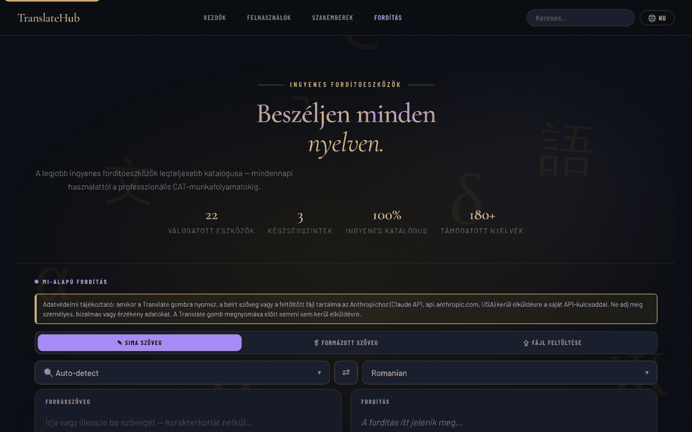

# TranslateHub

[English](README.md) · [Română](README.ro.md) · [Français](README.fr.md) · [Italiano](README.it.md) · [Español](README.es.md) · [Português](README.pt.md) · [Deutsch](README.de.md) · **Magyar**

**Verzió:** 1.3.10 · **Utolsó frissítés:** 2026-10-23

A felület nyelvei: **Română, English, Français, Italiano, Español, Português (PT), Deutsch, Magyar**

Ingyenes fordítóeszközök címtára beépített MI-fordítóval (Claude), egyetlen HTML-fájlban.

**Élő változat:** https://chiuta.github.io/TranslateHub/

## Mi ez

A TranslateHub egyetlen oldal (`index.html`), amely két dolgot egyesít:

- 22 ingyenes fordító- és nyelvészeti eszköz gondosan összeállított címtára (Google Translate, DeepL, Linguee, WordReference, MateCat, OmegaT, LibreTranslate stb.), három szintre csoportosítva: *Beginners*, *Average* és *Professionals*;
- egy MI-fordító, amely az Anthropic API-t (Claude) használja, a felhasználó által megadott API-kulccsal.

## Funkciók

- Címtár az egyes eszközök kártyáival (leírás, jellemzők, a nyelvek hozzávetőleges száma, „Open ↗” gomb), kereséssel („Search translation tools”) és szintenkénti navigációs hivatkozásokkal.
- Gyorsszűrők (chipek) a fordítóterület alatt, a kártyák címkéiből generálva (pl. „Open source”, „API”); billentyűparancsok: a `/` a keresőre teszi a fókuszt, az `Esc` kiüríti azt.
- Három MI-fordítási mód: **Plain Text**, **Rich Text** (formázósáv B / I / U / H1–H3 / listák / táblázat; `.html` exportálás) és **File Upload**.
- Fájlfeltöltés (legfeljebb 2 MB): `.txt`, `.md`, `.html`, `.docx`, `.srt`, `.po`, `.csv`, `.json`; a lefordított fájl előnézete és letöltése.
- A forrásnyelv („Auto-detect” lehetőséggel) és a célnyelv kiválasztása, felcserélő gomb (⇄; az „Auto-detect” esetén az utolsó fordításnál felismert nyelvet használja, ami lehetővé teszi az ellenőrzést visszafordítással), keresés a nyelvlistában.
- Karakter- és szószámláló, „Clear”, „Copy”, „↓ .txt” gombok.
- „Cancel” gomb a folyamatban lévő fordításhoz.
- A felület nyelve: „EN” választó a felső sávban. Beépített fordítások 20 nyelvre (en, ro, fr, es, de, it, pt, ru, zh-Hans, ja, ar, ko, tr, pl, nl, sv, cs, hu, el, hi); más nyelveknél a felületet a Claude API fordítja le, és helyben gyorsítótárazza. A személyesadat-ellenőrzés, a „mi megy ki” jelző és az előzmények szövegei 8 nyelven léteznek (ro, en, fr, it, es, pt, de, hu); a többi 12 beépített nyelven angolul jelennek meg.
- Jogi/adatvédelmi szakaszok az alkalmazásban (GDPR, tárolás a böngészőben, harmadik félnek történő átadás).

## Újdonságok (1.1.0)

- **Helyi személyesadat-ellenőrzés a „Translate” előtt** (`FFF.pii`), mindhárom módban (egyszerű szöveg, formázott szöveg, fájl): ha a szöveg e-mail-címeket, telefonszámokat, IBAN-t, CNP-t, kártyaszámokat, IP-címeket vagy kulcsokat tartalmaz, semmi sem indul el az `api.anthropic.com` felé, amíg nem választod a „A kijelöltek maszkolása és folytatás”, a „Folytatás maszkolás nélkül” vagy a „Mégse” lehetőséget. Ctrl+Enterrel is működik. Kikapcsolható (a beállítás megmarad).
- **„Mi megy ki” jelző:** „↗ A „Translate” gombra a szöveg az api.anthropic.com felé indul”, magyarázattal (a te kulcsod, csak a lapon tárolva). Az eszközcímtár és a keresés helyben fut.
- **Opcionális helyi fordítási előzmények (alapértelmezés szerint kikapcsolva):** csak az API-tól kapott valódi eredmények; „🗂 Fordítási előzmények” panel helyi szemantikus kereséssel (`FFF.search`), a forrásszöveg újrafelhasználásával, másolással, Markdown-exportálással, törléssel, a személyes adatok vizsgálatával/maszkolásával az előzményekben.
- **Titkosított mentés** az átláthatósági címkén keresztül (`FFF.bundle`). Az API-kulcs a `sessionStorage`-ban marad, és **nem** kerül bele a mentésbe.

### Korlátok
- A személyes adatok észlelése heurisztikus, és előfordulhat, hogy valamit kihagy; a maszkolás az értékeket címkékre cseréli, ami megváltoztathatja a fordítást.
- „Formázott szöveg” módban a maszkolás a szövegcsomópontokra vonatkozik; a formázás megmarad.
- Az előzményeknek van felső korlátja (200 bejegyzés / ~1,5 M karakter).

**FFF-kit.** Az `fff-kit` (az `index.html`-be beillesztve, hálózat nélkül) `core, label, bundle, pii, search` moduljait használja: átláthatósági címke (nyomd meg a verziót a láblécben), `.fff.json` exportálás/importálás/törlés opcionális AES-GCM + PBKDF2 titkosítással, helyi személyesadat-észlelés és helyi BM25-keresés. A CSP-szabályzat az előző verzióhoz képest **nem változott**, kivéve a beágyazott szkriptek `sha256` hash-eit (az új stílusok a `<style>` elemben vannak, amelyet a már meglévő `style-src 'unsafe-inline'` fed le; új host nem került hozzáadásra). Az új szövegek fr/it/es/pt/hu/de fordításai automatikusak, és **anyanyelvi beszélők nem ellenőrizték őket**. A személyes adatok észlelése heurisztikus: kihagyhat vagy tévesen jelezhet; nem helyettesíti a saját ellenőrzésedet.

## Használati útmutató

1. Nyisd meg az oldalt. Az MI-fordításhoz az „API key required” szalagban add meg az Anthropic-kulcsot az „Anthropic API key” mezőben, és nyomd meg a „Save key” gombot. A „Clear” törli; a „Get key ↗” megnyitja a kulcs beszerzésének oldalát.
2. Válaszd ki a módot: „✎ Plain Text”, „❡ Rich Text” vagy „⇪ File Upload”.
3. Válaszd ki a forrásnyelvet (vagy az „Auto-detect” lehetőséget) és a célnyelvet; a ⇄ felcseréli őket.
4. Írd be/illeszd be a szöveget (vagy húzd a fájlt a „Drop your file here” területre / kattints a kiválasztásához).
5. Nyomd meg a **Translate** gombot, vagy a `Ctrl+Enter` (`Cmd+Enter` macOS-en) billentyűkombinációt a szövegmezőben.
6. Másold ki az eredményt („⧉ Copy”), töltsd le („↓ .txt”, „↓ .html” vagy „↓ Download translated file”).
7. A felület nyelvének módosításához nyomd meg a nyelv gombot a felső sávban, és válaszd ki a nyelvet; a választás megmarad.
8. Az eszközcímtárhoz görgess a „Beginners”, „Average users” vagy „Professionals” részhez, vagy használd a keresést; az „Open ↗” új lapon nyitja meg az eszköz oldalát.

## Adatvédelem és hálózat

- **Helyi tárolás:** `localStorage` — a felület nyelvének kódja (`translatehub.ui_lang_pref`, `translatehub.ui_lang_name`) és a gyorsítótárazott felületi fordítások (`ui_<kód>`). `sessionStorage` — az Anthropic API-kulcs (`th_apikey`), a lap bezárásakor törlődik; szintén a `sessionStorage`-ban őrződik ideiglenesen a jogi/GDPR-szakaszok fordítása, ha az API-n keresztül kéred. Az alkalmazás nem állít be sütiket.
- **Hálózat:** az alkalmazás a `https://api.anthropic.com/v1/messages` címet **csak** akkor keresi meg, ha MI-fordítást használsz, vagy olyan felületi nyelvet választasz, amelyhez nincs beépített fordítás. A megadott szöveg (vagy a fájl tartalma) és a kulcsod az Anthropichoz kerül; az alkalmazás szabályzata megemlíti, hogy az Anthropic az adatokat legfeljebb 30 napig megőrzi. Az oldal biztonsági szabályzata (CSP) csak erre a hostra engedélyez kapcsolatokat (`connect-src https://api.anthropic.com`, `img-src 'self' data:`); a `script-src` csak az oldal saját, SHA-256 hash-sel azonosított szkriptjét engedi, beágyazott eseménykezelők nélkül.
- **Látható figyelmeztetés az MI-mód előtt:** a módválasztó felett a fordítópanel megjegyzést jelenít meg (EN, RO, FR, ES, DE, IT, PT, HU; a többi nyelv angolul kapja), amely szerint a szöveg vagy a fájl a felhasználó kulcsával az Anthropichoz (USA) kerül, nem szabad személyes/érzékeny adatokat megadni, és a „Translate” előtt semmi sem kerül elküldésre. Az alkalmazás GDPR-szövege összhangba került (már nem állítja, hogy az alkalmazás „nem kezel személyes adatokat”).
- A betűtípusok be vannak ágyazva a fájlba; a `.docx`-értelmező (mammoth.js) helyben, a `vendor/` mappában található.
- A címtár hivatkozásai az eszközök oldalaira egyszerű linkek; amíg meg nem nyitod őket, nem indul feléjük kérés.
- Nincs analitika és nincsenek reklámok (az alkalmazás megjegyzése szerint).

## Futtatás helyben / offline

Töltsd le az `index.html` fájlt (és `.docx` fájlokhoz a `vendor/` mappát), és nyisd meg böngészőben. Az eszközcímtár és a 20 beépített nyelvű felület internet nélkül is működik; az MI-fordításhoz internetkapcsolat és Anthropic API-kulcs szükséges.

## Előzmények / Changelog

### 1.3.9 — 2026-10-23

- A helyi tárhely kulcsai mostantól a `translatehub.` előtagot használják (`FFF.store.migrate` induláskor, bármilyen olvasás előtt): a meglévő adatok automatikusan megmaradnak, a régi `.fff.json` mentések továbbra is importálhatók.

### 1.3.7 — 2026-10-22
- fff-kit 1.1.4: érintési célpontok és minimális szövegméret; érintési célpontok/szöveg javítva

### 1.3.6 — 2026-10-22
- Akadálymentesség: jól látható fókuszkeret a forrásszöveg-panelen, a nyelvválasztókon és a többi beviteli mezőn (legalább 3:1 kontraszt).

### 1.3.5 — 2026-10-22
- fff-kit 1.1.2: PBKDF2 600 000 iterációval, clickjacking elleni védelem.

### 1.3.4 — 2026-10-22
- API-kulcs nélkül nincs kérés: a Fordítás gomb kulcs nélkül már nem hívja az api.anthropic.com-ot (nincs preflight, nincs újrapróba), hanem azonnal megjeleníti a kulcssávot és egy üzenetet.
- Hozzájárulás az első küldéskor: egy párbeszédablak jelzi, hogy a szöveg a saját kulcsoddal az api.anthropic.com-ra kerül; megerősítésig semmi sem megy el.
- Opcionális, ellenőrzött modellmező a kulcs mellett; a nagy szövegeknél használt alert()/confirm() helyett oldalon belüli ablakok és értesítések.
- Mobil: nincs 12 px alatti szöveg, az érintési célpontok legalább 24 px-esek (WCAG 2.5.8).

### 1.3.3 — 2026-10-22
- A felületnyelv-választó nyelvnevei lokalizáltak (exonimák az aktuális nyelven, angol névre és endonimára is kereshetők); a két megmaradt cím (IATE, szószedet- és fordításimemória-források), a „Jogi szakaszok” aria-label és a Ctrl+Enter-súgó le van fordítva. A kérésre generált jogi szövegek úgy maradnak, ahogy az API visszaadja.

### 1.3.2 — 2026-10-22
- Fordítási javítások: az oldalcím és a meta címkék követik a felület nyelvét; az üzenetek, értesítések, folyamatszöveg, nyelvnevek, címkék és az API-kulcs sáv lefordítva; a karakterszámláló már nem tűnik el nyelvváltáskor. A jogi szövegek és a terméknevek szándékosan angolul maradnak.

### 2026. október 19. — 1.3.1 verzió
- A „Translate” előtti személyesadat-ellenőrzés, a „mi megy ki” jelző és az opcionális helyi előzmények (lásd 1.1.0) megvannak a jelenlegi verzióban: egy korábbi takarításkor tévedésből eltávolították őket, és (1.3.0) azonos viselkedéssel, új tesztekkel újra megvalósítottuk őket. Az eszközkártyák leírásai és a figyelmeztető/megerősítő üzenetek le vannak fordítva a 8 nyelvre (ro, en, fr, it, es, pt, de, hu).

### 2026. október 14. — 1.1.0 verzió
- Helyi személyesadat-ellenőrzés küldés előtt, „mi megy ki” jelző, opcionális kereshető helyi előzmények, titkosított `.fff.json` mentés, átláthatósági címke; tesztek a `tests/fff-r8.test.mjs` fájlban.

### 2026. október 12. — 1.0.0 verzió
- 1.0.0 — 2026-10-12: a verzió és az utolsó frissítés dátuma megjelenik az alkalmazásban

### 2026. október 11. (harmadik menet)
- A ⇄ gomb az „Auto-detect” forrással is működik: az utolsó fordításnál felismert nyelvet használja (a „Detected: …” jelvény), így az ellenőrző visszafordítás egyetlen kattintás; ellenkező esetben az üzenet elmagyarázza, mit kell tenni. Szimulált API-válasszal ellenőrizve (hálózat nélkül). CSP: a hash újraszámolva.

### 2026. október 11. (második menet)
- Címtár: gyorsszűrők címkék szerint (automatikusan generálva a kártyákból, új adatok nélkül) és billentyűparancsok a kereséshez (`/`, `Esc`); a Translate gomb címként a `Ctrl+Enter` kombinációt mutatja. CSP: a szkript hash-e újraszámolva.

### 2026. október 11.
- Hozzáférhetőség: az oldal tartalma (a fordítóterületet is beleértve) mostantól `<main>` elembe van foglalva, a támogatói widget pedig mérföldkő szerepű; az axe-core 0 szabálysértést jelez 1280 és 360 px-en.
- Biztonság: a beágyazott `onclick` eseménykezelőket delegált eseménykezelő váltotta fel, a CSP pedig csak az oldal saját szkriptjét engedi SHA-256 hash alapján (a `script-src`-ben `'unsafe-inline'` nélkül).
- API-kulcs nélkül a „Failed to fetch” hibát kifejezett üzenet váltja fel, az „API key required” szalag pedig megjelenik, és fókuszt kap.
- A „100% Free to use” címke „Free directory” lett (mind a 20 nyelven): a címtár ingyenes, de az MI-fordítás a felhasználó saját, általa fizetett API-kulcsát használja.
- Frissített adatok: Google Translate 249 nyelv, DeepL 120 nyelv; a DeepL „3 dokumentum/hó” korlátja eltávolítva (nem lehetett megerősíteni). A jogi szakaszok „Last updated” szövegei: 2026. október.

**2026. 10. 11-én ellenőrzött források:** Wikipedia — Google Translate (249 nyelv, 2026. szeptember); Wikipedia — DeepL Translator (120 nyelv, 2026. július).

## Licenc

MIT — lásd a LICENSE fájlt

## Audit

Audit: 2026-10-10 (átdolgozva 2026-10-11) — a README leírásai megfelelnek a kódnak (az egyetlen megkeresett host: `api.anthropic.com`, csak MI-fordításkor / a felület beépített fordítással nem rendelkező nyelvekre fordításakor). Kisebb hozzáférhetőségi javítások (kontraszt, fókusz). A gépi fordítás hibákat tartalmazhat; hivatalos dokumentumokhoz vagy érzékeny személyes adatokat tartalmazó anyagokhoz ellenőrzés nélkül ne használd.

## Szerző

Alexio — Alexandru-Ionuț Chiuță. Elérhetőség: alexio@trom.tf

## Összefoglaló

A TranslateHub egyfájlos HTML-oldal 22 ingyenes fordítóeszköz gondosan összeállított címtárával, valamint egy MI-fordítóval (egyszerű szöveg, formázott szöveg, fájlfeltöltés 8 formátumhoz), amely az Anthropic API-t a felhasználó saját, a sessionStorage-ban tartott kulcsával hívja meg. A felület 20 beépített nyelvvel érkezik. Az egyetlen megkeresett host az api.anthropic.com, és csak az MI-funkciók használatakor. MIT licenc.
