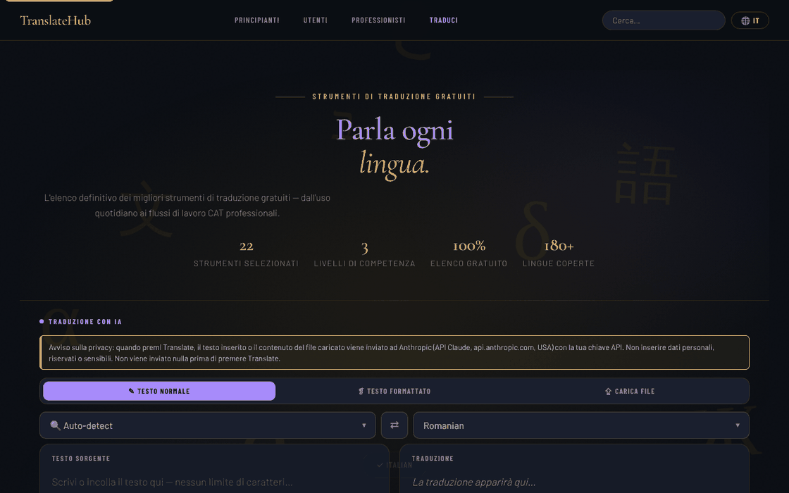

# TranslateHub

[English](README.md) · [Română](README.ro.md) · [Français](README.fr.md) · **Italiano** · [Español](README.es.md) · [Português](README.pt.md) · [Deutsch](README.de.md) · [Magyar](README.hu.md)

**Versione:** 2.1.1 · **Ultimo aggiornamento:** 2026-10-31

**Stato:** stabile · **Offline:** richiede Internet per la traduzione IA con Claude (e le lingue dell'interfaccia senza traduzione integrata); con il motore locale Ollama nulla passa da Internet, ma serve un server Ollama attivo su questo computer

Lingue dell'interfaccia: **Română, English, Français, Italiano, Español, Português (PT), Deutsch, Magyar**

Un elenco di strumenti di traduzione gratuiti, con un traduttore IA integrato (Claude), in un unico file HTML.

**Online:** https://chiuta.github.io/TranslateHub/

## Che cos'è

TranslateHub è una pagina unica (`index.html`) che combina due cose:

- un elenco curato di 22 strumenti gratuiti di traduzione e linguistica (Google Translate, DeepL, Linguee, WordReference, MateCat, OmegaT, LibreTranslate ecc.), raggruppati su tre livelli: *Beginners*, *Average* e *Professionals*;
- un traduttore IA che usa l'API di Anthropic (Claude), con la chiave API fornita dall'utente.

## Funzioni

- Elenco con schede per ogni strumento (descrizione, caratteristiche, numero approssimativo di lingue, pulsante «Open ↗»), con ricerca («Search translation tools») e link di navigazione per livello.
- Filtri rapidi (chips) sotto l'area del traduttore, generati dalle etichette delle schede (ad es. «Open source», «API»); scorciatoie: `/` sposta il focus sulla ricerca, `Esc` la svuota.
- Tre modalità di traduzione con IA: **Plain Text**, **Rich Text** (barra di formattazione B / I / U / H1–H3 / elenchi / tabella; esportazione `.html`) e **File Upload**.
- Caricamento di file (max. 2 MB): `.txt`, `.md`, `.html`, `.docx`, `.srt`, `.po`, `.csv`, `.json`; anteprima e download del file tradotto.
- Scelta della lingua di partenza (con «Auto-detect») e della lingua di arrivo, pulsante di inversione (⇄; con «Auto-detect» usa la lingua rilevata nell'ultima traduzione, il che permette la verifica tramite retrotraduzione), ricerca nell'elenco delle lingue.
- Contatore di caratteri e parole, pulsanti «Clear», «Copy», «↓ .txt».
- Pulsante «Cancel» per una traduzione in corso.
- Lingua dell'interfaccia: selettore «EN» nella barra superiore. Traduzioni integrate per 20 lingue (en, ro, fr, es, de, it, pt, ru, zh-Hans, ja, ar, ko, tr, pl, nl, sv, cs, hu, el, hi); per le altre lingue l'interfaccia viene tradotta tramite l'API di Claude e conservata nella cache locale. I testi della verifica dei dati personali, dell'indicatore «cosa parte» e della cronologia esistono in 8 lingue (ro, en, fr, it, es, pt, de, hu); nelle altre 12 lingue integrate compaiono in inglese.
- Sezioni legali/sulla privacy nell'applicazione (GDPR, archiviazione nel browser, trasferimenti a terzi).

## Novità (1.1.0)

- 1.3.7 — 2026-10-22: fff-kit 1.1.4: bersagli touch e testo minimo; bersagli touch/testo corretti
- **Verifica locale dei dati personali prima di «Translate»** (`FFF.pii`), in tutte e tre le modalità (testo semplice, testo formattato, file): se il testo contiene e-mail, telefoni, IBAN, CNP, carte, IP o chiavi, nulla parte verso `api.anthropic.com` finché non scegli «Maschera quelli selezionati e continua», «Continua senza mascherare» o «Annulla». Funziona anche con Ctrl+Invio. Si può disattivare (la preferenza viene conservata).
- **Indicatore «cosa parte»:** «↗ Con «Translate», il testo parte verso api.anthropic.com», con una spiegazione (la tua chiave, conservata solo nella scheda). L'elenco degli strumenti e la ricerca girano in locale.
- **Cronologia locale delle traduzioni, facoltativa (disattivata per impostazione predefinita):** solo risultati reali ricevuti dall'API; pannello «🗂 Cronologia delle traduzioni» con ricerca semantica locale (`FFF.search`), riutilizzo del testo di partenza, copia, esportazione Markdown, eliminazione, scansione/mascheratura dei dati personali nella cronologia.
- **Copia cifrata** tramite l'etichetta di trasparenza (`FFF.bundle`). La chiave API resta in `sessionStorage` e **non** entra nella copia.

### Limiti
- Il rilevamento dei dati personali è euristico e può lasciarsi sfuggire qualcosa; la mascheratura sostituisce i valori con etichette, il che può cambiare la traduzione.
- In modalità «testo formattato» la mascheratura si applica ai nodi di testo; la formattazione resta.
- La cronologia ha un tetto (200 voci / ~1,5 M di caratteri).

**Kit FFF.** Da `fff-kit` (incorporato in `index.html`, senza rete) si usano i moduli `core, label, bundle, pii, search`: etichetta di trasparenza (premi la versione nel piè di pagina), esportazione/importazione/cancellazione `.fff.json` con cifratura facoltativa AES-GCM + PBKDF2, rilevamento locale dei dati personali e ricerca locale BM25. La politica CSP **non è stata modificata** rispetto alla versione precedente, a parte gli hash `sha256` degli script inline (i nuovi stili sono in `<style>`, coperto dallo `style-src 'unsafe-inline'` già presente; non è stato aggiunto alcun nuovo host). Le traduzioni dei nuovi testi in fr/it/es/pt/hu/de sono automatiche e **non verificate da madrelingua**. Il rilevamento dei dati personali è euristico: può mancare o segnalare erroneamente; non sostituisce la tua verifica.

## Guida all'uso

1. Apri la pagina. Per la traduzione con IA, nel banner «API key required» inserisci la chiave Anthropic nel campo «Anthropic API key» e premi «Save key». «Clear» la cancella; «Get key ↗» apre la pagina per ottenere la chiave.
2. Scegli la modalità: «✎ Plain Text», «❡ Rich Text» o «⇪ File Upload».
3. Scegli la lingua di partenza (o «Auto-detect») e la lingua di arrivo; ⇄ le inverte.
4. Scrivi/incolla il testo (oppure trascina il file nell'area «Drop your file here» / clicca per sceglierlo).
5. Premi il pulsante **Translate** o `Ctrl+Invio` (`Cmd+Invio` su macOS) nel campo di testo.
6. Copia il risultato («⧉ Copy»), scaricalo («↓ .txt», «↓ .html» o «↓ Download translated file»).
7. Per cambiare la lingua dell'interfaccia, premi il pulsante della lingua nella barra superiore e scegli la lingua; la scelta viene memorizzata.
8. Per l'elenco degli strumenti, scorri fino a «Beginners», «Average users» o «Professionals» oppure usa la ricerca; «Open ↗» apre il sito dello strumento in una nuova scheda.

## Privacy e rete

- **Archiviazione locale:** `localStorage` — il codice della lingua dell'interfaccia (`translatehub.ui_lang_pref`, `translatehub.ui_lang_name`) e le traduzioni dell'interfaccia in cache (`ui_<codice>`). `sessionStorage` — la chiave API Anthropic (`th_apikey`), cancellata alla chiusura della scheda; sempre in `sessionStorage` viene conservata temporaneamente la traduzione delle sezioni legali/GDPR, se la richiedi tramite API. L'applicazione non imposta cookie.
- **Rete:** l'applicazione contatta `https://api.anthropic.com/v1/messages` **solo** quando usi la traduzione con IA o quando scegli una lingua dell'interfaccia senza traduzione integrata. Il testo inserito (o il contenuto del file) e la tua chiave vengono inviati ad Anthropic; la politica dell'applicazione menziona la conservazione dei dati da parte di Anthropic fino a 30 giorni. La politica di sicurezza della pagina (CSP) consente connessioni solo verso questo host (`connect-src https://api.anthropic.com`, `img-src 'self' data:`); `script-src` consente solo lo script proprio, identificato da un hash SHA-256, senza gestori inline. Con il motore locale opzionale (Ollama), la CSP consente anche `http://localhost:11434` e `http://127.0.0.1:11434` (nient’altro).
- **Avviso visibile prima della modalità IA:** sopra il selettore delle modalità, il pannello di traduzione mostra una nota (EN, RO, FR, ES, DE, IT, PT, HU; le altre lingue la ricevono in inglese) che dice che il testo o il file vengono inviati ad Anthropic (USA), con la chiave dell'utente, che non vanno inseriti dati personali/sensibili e che nulla viene inviato prima di «Translate». Il testo GDPR dell'applicazione è stato allineato (non afferma più che l'applicazione «non tratta dati personali»).
- I font sono incorporati nel file; il parser `.docx` (mammoth.js) è incluso in locale in `vendor/`.
- I link dell'elenco verso i siti degli strumenti sono semplici collegamenti; non viene fatta alcuna richiesta verso di essi finché non li apri.
- Nessuna analitica e nessuna pubblicità (secondo la nota nell'applicazione).

## Esecuzione locale / offline

Scarica `index.html` (e, per i file `.docx`, la cartella `vendor/`) e aprilo nel browser. L'elenco degli strumenti e l'interfaccia nelle 20 lingue integrate funzionano senza internet; la traduzione con IA richiede una connessione a internet e una chiave API Anthropic.

## Cronologia / Changelog

### 1.3.9 — 2026-10-23

- Le chiavi dell'archiviazione locale usano ora il prefisso `translatehub.` (`FFF.store.migrate` all'avvio, prima di qualsiasi lettura): i dati esistenti vengono conservati automaticamente e i vecchi backup `.fff.json` si possono ancora importare.

### 1.3.6 — 2026-10-22
- Accessibilità: anello di focus chiaro sul pannello del testo di partenza, sui selettori di lingua e sugli altri campi (contrasto di almeno 3:1).

### 1.3.5 — 2026-10-22
- fff-kit 1.1.2: PBKDF2 a 600.000 iterazioni, protezione anti-clickjacking.

### 1.3.4 — 2026-10-22
- Senza chiave API, nessuna richiesta: premere Traduci senza chiave non chiama più api.anthropic.com (niente preflight né nuovi tentativi) e mostra subito la barra della chiave con un messaggio.
- Consenso al primo invio: una finestra spiega che il testo va a api.anthropic.com con la tua chiave; nulla viene inviato prima della conferma.
- Campo «modello» facoltativo e validato accanto alla chiave; gli alert()/confirm() per i testi grandi sono sostituiti da finestre e notifiche nella pagina.
- Mobile: nessun testo sotto i 12 px e aree tattili di almeno 24 px (WCAG 2.5.8).

### 1.3.3 — 2026-10-22
- I nomi delle lingue nel selettore della lingua dell'interfaccia sono ora localizzati (esonimi nella lingua corrente, ricercabili anche per nome inglese ed endonimo); le due intestazioni rimaste (IATE, risorse per glossari e memorie di traduzione), l'aria-label «Sezioni legali» e il suggerimento Ctrl+Invio sono tradotti. I testi legali generati su richiesta restano quelli restituiti dall'API.

### 1.3.2 — 2026-10-22
- Correzioni di traduzione: il titolo della pagina e i meta tag seguono la lingua dell’interfaccia; messaggi, notifiche, testo di avanzamento, nomi delle lingue, tag e banner della chiave API tradotti; il contatore dei caratteri non scompare più al cambio di lingua. I testi legali e i nomi dei prodotti restano intenzionalmente in inglese.

### 19 ottobre 2026 — versione 1.3.1
- La verifica dei dati personali prima di «Translate», l'indicatore «cosa parte» e la cronologia locale facoltativa (vedi 1.1.0) sono presenti nella versione attuale: erano stati rimossi per errore in una pulizia precedente e sono stati reimplementati (1.3.0) con lo stesso comportamento e nuovi test. Le descrizioni delle schede degli strumenti e i messaggi di avviso/conferma sono tradotti nelle 8 lingue (ro, en, fr, it, es, pt, de, hu).

### 14 ottobre 2026 — versione 1.1.0
- Verifica locale dei dati personali prima dell'invio, indicatore «cosa parte», cronologia locale facoltativa con ricerca, copia cifrata `.fff.json`, etichetta di trasparenza; test in `tests/fff-r8.test.mjs`.

### 12 ottobre 2026 — versione 1.0.0
- 1.0.0 — 2026-10-12: la versione e la data dell'ultimo aggiornamento sono mostrate nell'app

### 11 ottobre 2026 (terzo passaggio)
- Il pulsante ⇄ funziona anche con la sorgente «Auto-detect»: usa la lingua rilevata nell'ultima traduzione (il badge «Detected: …»), così la retrotraduzione di verifica richiede un solo clic; altrimenti il messaggio spiega cosa fare. Verificato con una risposta API simulata (senza rete). CSP: hash ricalcolato.

### 11 ottobre 2026 (secondo passaggio)
- Elenco: filtri rapidi per etichette (generati automaticamente dalle schede, senza dati nuovi) e scorciatoie da tastiera per la ricerca (`/`, `Esc`); il pulsante Translate mostra `Ctrl+Enter` come titolo. CSP: hash dello script ricalcolato.

### 11 ottobre 2026
- Accessibilità: il contenuto della pagina (compresa l'area del traduttore) è ora racchiuso in `<main>`, e il widget di sostegno ha un ruolo di punto di riferimento; axe-core segnala 0 violazioni a 1280 e 360 px.
- Sicurezza: i gestori `onclick` inline sono stati sostituiti da un gestore delegato, e la CSP consente solo lo script proprio tramite hash SHA-256 (senza `'unsafe-inline'` in `script-src`).
- Senza chiave API, l'errore «Failed to fetch» è sostituito da un messaggio esplicito, e il banner «API key required» viene mostrato e riceve il focus.
- L'etichetta «100% Free to use» è diventata «Free directory» (in tutte e 20 le lingue): l'elenco è gratuito, ma la traduzione con IA usa la chiave API propria, pagata dall'utente.
- Dati aggiornati: Google Translate 249 lingue, DeepL 120 lingue; limite DeepL di «3 documenti/mese» rimosso (non è stato possibile confermarlo). I testi «Last updated» delle sezioni legali: ottobre 2026.

**Fonti verificate l'11.10.2026:** Wikipedia — Google Translate (249 lingue, settembre 2026); Wikipedia — DeepL Translator (120 lingue, luglio 2026).

## Licenza

MIT — vedi il file LICENSE

## Audit

Audit: 2026-10-10 (rivisto 2026-10-11) — le descrizioni del README corrispondono al codice (l'unico host contattato: `api.anthropic.com`, solo per la traduzione con IA / per la traduzione dell'interfaccia in lingue senza traduzione integrata). Correzioni minori di accessibilità (contrasto, focus). La traduzione automatica può contenere errori; non usarla senza verifica per documenti ufficiali o con dati personali sensibili.

## Autore

Alexio — Alexandru-Ionuț Chiuță. Contatto: alexio@trom.tf

## Riepilogo

TranslateHub è una pagina HTML in un unico file con un elenco curato di 22 strumenti di traduzione gratuiti più un traduttore IA (testo semplice, testo formattato, caricamento di file in 8 formati) che chiama l'API di Anthropic con la chiave propria dell'utente, conservata in sessionStorage. L'interfaccia è fornita con 20 lingue integrate. L'unico host contattato è api.anthropic.com, e solo quando si usano le funzioni di IA. Licenza MIT.
