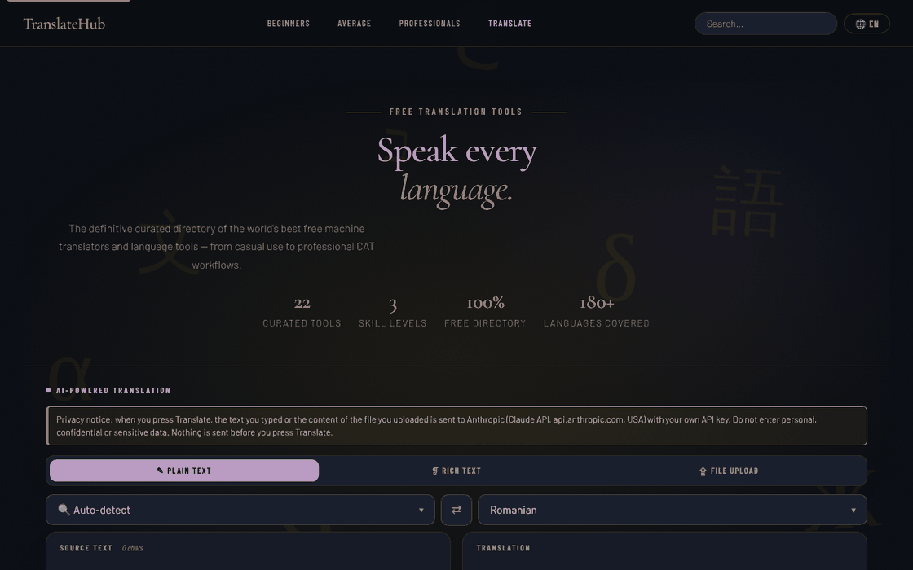

# TranslateHub

**English** · [Română](README.ro.md) · [Français](README.fr.md) · [Italiano](README.it.md) · [Español](README.es.md) · [Português](README.pt.md) · [Deutsch](README.de.md) · [Magyar](README.hu.md)

**Version:** 1.3.11 · **Last updated:** 2026-10-26

Interface languages: **Română, English, Français, Italiano, Español, Português (PT), Deutsch, Magyar**

A directory of free translation tools, with a built-in AI translator (Claude), in a single HTML file.

**Live:** https://chiuta.github.io/TranslateHub/

## What it is

TranslateHub is a single page (`index.html`) that combines two things:

- a curated directory of 22 free translation and linguistics tools (Google Translate, DeepL, Linguee, WordReference, MateCat, OmegaT, LibreTranslate, etc.), grouped on three levels: *Beginners*, *Average* and *Professionals*;
- an AI translator that uses the Anthropic API (Claude), with the API key supplied by the user.

## Features

- Directory with cards for each tool (description, features, approximate number of languages, "Open ↗" button), with search ("Search translation tools") and navigation links by level.
- Quick filters (chips) below the translator area, generated from the cards' tags (e.g. "Open source", "API"); shortcuts: `/` moves focus to search, `Esc` clears it.
- Three AI translation modes: **Plain Text**, **Rich Text** (formatting bar B / I / U / H1–H3 / lists / table; `.html` export) and **File Upload**.
- File upload (max. 2 MB): `.txt`, `.md`, `.html`, `.docx`, `.srt`, `.po`, `.csv`, `.json`; preview and download of the translated file.
- Choice of the source language (with "Auto-detect") and the target language, a swap button (⇄; with "Auto-detect" it uses the language detected in the last translation, which allows checking by back-translation), search in the language list.
- Character and word counter, "Clear", "Copy", "↓ .txt" buttons.
- "Cancel" button for a translation in progress.
- Interface language: "EN" selector in the top bar. Built-in translations for 20 languages (en, ro, fr, es, de, it, pt, ru, zh-Hans, ja, ar, ko, tr, pl, nl, sv, cs, hu, el, hi); for other languages the interface is translated through the Claude API and cached locally. The texts of the personal-data check, the "what leaves" indicator and the history exist in 8 languages (ro, en, fr, it, es, pt, de, hu); in the other 12 built-in languages they appear in English.
- Legal/privacy sections in the app (GDPR, browser storage, transfers to third parties).

## New features (1.1.0)

- **Local personal-data check before "Translate"** (`FFF.pii`), in all three modes (plain text, rich text, file): if the text contains emails, phone numbers, IBANs, personal ID numbers (CNP), cards, IPs or keys, nothing leaves for `api.anthropic.com` until you choose "Mask the ticked items and continue", "Continue without masking" or "Cancel". It also works with Ctrl+Enter. It can be turned off (the preference is kept).
- **"What leaves" indicator:** "↗ On "Translate", the text goes to api.anthropic.com", with an explanation (your key, kept only in the tab). The tool directory and search run locally.
- **Optional local translation history (off by default):** only real results received from the API; a "🗂 Translation history" panel with local semantic search (`FFF.search`), reuse of the source text, copy, Markdown export, deletion, scanning/masking of personal data in the history.
- **Encrypted backup** through the transparency label (`FFF.bundle`). The API key stays in `sessionStorage` and does **not** go into the backup.

### Limits
- Personal-data detection is heuristic and may miss something; masking replaces values with labels, which may change the translation.
- In "rich text" mode the masking is applied to text nodes; the formatting remains.
- The history has a cap (200 entries / ~1.5 M characters).

**FFF kit.** From `fff-kit` (pasted into `index.html`, no network) the modules `core, label, bundle, pii, search` are used: transparency label (press the version in the footer), `.fff.json` export/import/deletion with optional AES-GCM + PBKDF2 encryption, local personal-data detection and local BM25 search. The CSP policy **was not changed** compared with the previous version apart from the `sha256` hashes of the inline scripts (the new styles are in `<style>`, covered by the `style-src 'unsafe-inline'` already present; no new host was added). The translations of the new texts into fr/it/es/pt/hu/de are automatic and **not verified by native speakers**. Personal-data detection is heuristic: it may miss or wrongly flag; it does not replace your own checking.

## User guide

1. Open the page. For AI translation, in the "API key required" banner enter the Anthropic key in the "Anthropic API key" field and press "Save key". "Clear" deletes it; "Get key ↗" opens the page for obtaining the key.
2. Choose the mode: "✎ Plain Text", "❡ Rich Text" or "⇪ File Upload".
3. Choose the source language (or "Auto-detect") and the target language; ⇄ swaps them.
4. Type/paste the text (or drag the file into the "Drop your file here" area / click to choose it).
5. Press the **Translate** button or `Ctrl+Enter` (`Cmd+Enter` on macOS) in the text field.
6. Copy the result ("⧉ Copy"), download it ("↓ .txt", "↓ .html" or "↓ Download translated file").
7. To change the interface language, press the language button in the top bar and choose the language; the choice is remembered.
8. For the tool directory, scroll to "Beginners", "Average users" or "Professionals" or use the search; "Open ↗" opens the tool's site in a new tab.

## Privacy and network

- **Local storage:** `localStorage` — the interface language code (`translatehub.ui_lang_pref`, `translatehub.ui_lang_name`) and the cached interface translations (`translatehub.ui_<code>`). `sessionStorage` — the Anthropic API key (`th_apikey`), deleted when the tab is closed; the translation of the legal/GDPR sections is also kept temporarily in `sessionStorage`, if you request it through the API. The app sets no cookies.
- **Network:** the app contacts `https://api.anthropic.com/v1/messages` **only** when you use AI translation or when you choose an interface language with no built-in translation. The text you enter (or the file content) and your key are sent to Anthropic; the app's policy mentions Anthropic's retention of data for up to 30 days. The page's security policy (CSP) allows connections only to this host (`connect-src https://api.anthropic.com`, `img-src 'self' data:`); `script-src` allows only the page's own script, identified by a SHA-256 hash, with no inline handlers.
- **Visible warning before AI mode:** above the mode selector, the translation panel displays a note (EN, RO, FR, ES, DE, IT, PT, HU; the other languages get it in English) saying that the text or file is sent to Anthropic (USA), with the user's key, that no personal/sensitive data should be entered, and that nothing is sent before "Translate". The GDPR text in the app was aligned (it no longer states that the app "does not process personal data").
- Fonts are embedded in the file; the `.docx` parser (mammoth.js) is included locally in `vendor/`.
- The links in the directory to the tools' sites are plain links; no request is made to them until you open them.
- No analytics and no ads (according to the note in the app).

## Running locally / offline

Download `index.html` (and, for `.docx` files, the `vendor/` folder) and open it in a browser. The tool directory and the interface in the 20 built-in languages work without internet; AI translation requires an internet connection and an Anthropic API key.

## History / Changelog

### 1.3.10 — 2026-10-23

- Accessibility: on touch screens (`pointer:coarse`) navigation links, tag chips, tool links, the language, copy, clear and history buttons are at least 44 px. No change on desktop.
- Security (defence in depth): the sanitizer for the translated Legal & GDPR text now also removes `<noscript>` and `<template>`.

### 1.3.9 — 2026-10-23

- Local storage keys now use the `translatehub.` prefix (`FFF.store.migrate` at startup, before any read): existing data is kept automatically, and old `.fff.json` backups can still be imported.

### 1.3.7 — 2026-10-22
- fff-kit 1.1.4: touch targets and minimum text size; touch targets/text fixed

### 1.3.6 — 2026-10-22
- Accessibility: clear focus ring on the source-text panel, the language selectors and the other input fields (contrast of at least 3:1).

### 1.3.5 — 2026-10-22
- fff-kit 1.1.2: PBKDF2 600,000 iterations, anti-clickjacking protection.

### 1.3.4 — 2026-10-22
- No API key, no request: pressing Translate without a key no longer calls api.anthropic.com (no preflight, no retries) and immediately shows the key bar plus a message.
- First-send consent: a dialog explains that the text goes to api.anthropic.com with your own key; nothing is sent until you confirm.
- Optional, validated model field next to the key; the large-input alert()/confirm() were replaced by in-page dialogs and toasts.
- Mobile: no text below 12 px and touch targets of at least 24 px (WCAG 2.5.8).

### 1.3.3 — 2026-10-22
- Language names in the interface-language picker are now localized (exonyms in the current interface language, searchable also by English name and endonym); the two remaining headings (IATE, Glossary & TM resources), the “Legal sections” aria-label and the Ctrl+Enter hint are translated. Legal texts generated on request stay as returned by the API.

### 1.3.2 — 2026-10-22
- Translation fixes: page title and meta tags follow the interface language; messages, toasts, progress text, language names, tag chips and the API-key banner are translated; the #char-count counter no longer disappears after a language switch. Legal texts and product names intentionally stay in English.

### 19 October 2026 — version 1.3.1
- The personal-data check before "Translate", the "what leaves" indicator and the optional local history (see 1.1.0) are present in the current version: they had been removed by mistake in an earlier cleanup and were reimplemented (1.3.0) with the same behaviour and new tests. The descriptions of the tool cards and the alert/confirmation messages are translated into the 8 languages (ro, en, fr, it, es, pt, de, hu).

### 14 October 2026 — version 1.1.0
- Local personal-data check before sending, "what leaves" indicator, optional searchable local history, encrypted `.fff.json` backup, transparency label; tests in `tests/fff-r8.test.mjs`.

### 12 October 2026 — version 1.0.0
- 1.0.0 — 2026-10-12: the version and the date of the last update are shown in the app

### 11 October 2026 (third pass)
- The ⇄ button also works with the "Auto-detect" source: it uses the language detected in the last translation (the "Detected: …" badge), so back-translation for checking is a single click; otherwise the message explains what to do. Verified with a simulated API response (no network). CSP: hash recalculated.

### 11 October 2026 (second pass)
- Directory: quick filters by tags (generated automatically from the cards, no new data) and keyboard shortcuts for search (`/`, `Esc`); the Translate button shows `Ctrl+Enter` as its title. CSP: the script hash recalculated.

### 11 October 2026
- Accessibility: the page content (including the translator area) is now wrapped in `<main>`, and the support widget has a landmark role; axe-core reports 0 violations at 1280 and 360 px.
- Security: the inline `onclick` handlers were replaced by a delegated handler, and the CSP allows only the page's own script by SHA-256 hash (no `'unsafe-inline'` in `script-src`).
- Without an API key, the "Failed to fetch" error is replaced by an explicit message, and the "API key required" banner is displayed and receives focus.
- The "100% Free to use" label became "Free directory" (in all 20 languages): the directory is free, but AI translation uses the user's own API key, paid for by the user.
- Data updated: Google Translate 249 languages, DeepL 120 languages; DeepL's "3 documents/month" limit removed (it could not be confirmed). The "Last updated" texts in the legal sections: October 2026.

**Sources checked on 11.10.2026:** Wikipedia — Google Translate (249 languages, September 2026); Wikipedia — DeepL Translator (120 languages, July 2026).

## License

MIT — see the LICENSE file

## Audit

Audit: 2026-10-10 (revised 2026-10-11) — the descriptions in the README match the code (the only host contacted: `api.anthropic.com`, only for AI translation / for translating the interface into languages with no built-in translation). Minor accessibility fixes (contrast, focus). Machine translation may contain errors; do not use it without checking for official documents or those with sensitive personal data.

## Author

Alexio — Alexandru-Ionuț Chiuță. Contact: alexio@trom.tf

## Summary

TranslateHub is a single-file HTML page with a curated directory of 22 free translation tools plus an AI translator (plain text, rich text, file upload for 8 formats) that calls the Anthropic API with the user's own key, kept in sessionStorage. The UI ships with 20 built-in languages. The only host contacted is api.anthropic.com, and only when AI features are used. MIT licence.
