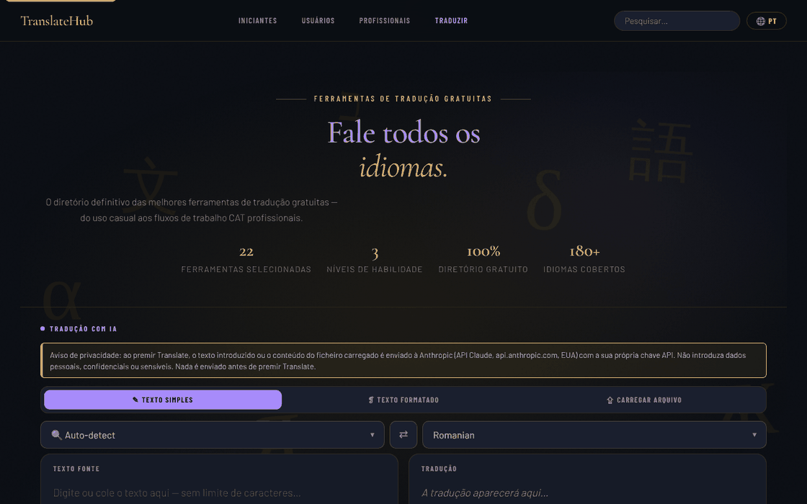

# TranslateHub

[English](README.md) · [Română](README.ro.md) · [Français](README.fr.md) · [Italiano](README.it.md) · [Español](README.es.md) · **Português** · [Deutsch](README.de.md) · [Magyar](README.hu.md)

**Versão:** 1.3.6 · **Última atualização:** 2026-10-22

Idiomas da interface: **Română, English, Français, Italiano, Español, Português (PT), Deutsch, Magyar**

Um diretório de ferramentas de tradução gratuitas, com um tradutor de IA integrado (Claude), num único ficheiro HTML.

**Online:** https://chiuta.github.io/TranslateHub/

## O que é

O TranslateHub é uma página única (`index.html`) que combina duas coisas:

- um diretório selecionado de 22 ferramentas gratuitas de tradução e linguística (Google Translate, DeepL, Linguee, WordReference, MateCat, OmegaT, LibreTranslate, etc.), agrupadas em três níveis: *Beginners*, *Average* e *Professionals*;
- um tradutor de IA que usa a API da Anthropic (Claude), com a chave API fornecida pelo utilizador.

## Funcionalidades

- Diretório com fichas de cada ferramenta (descrição, características, número aproximado de idiomas, botão «Open ↗»), com pesquisa («Search translation tools») e ligações de navegação por níveis.
- Filtros rápidos (chips) por baixo da zona do tradutor, gerados a partir das etiquetas das fichas (p. ex. «Open source», «API»); atalhos: `/` move o foco para a pesquisa, `Esc` esvazia-a.
- Três modos de tradução com IA: **Plain Text**, **Rich Text** (barra de formatação B / I / U / H1–H3 / listas / tabela; exportação `.html`) e **File Upload**.
- Carregamento de ficheiros (máx. 2 MB): `.txt`, `.md`, `.html`, `.docx`, `.srt`, `.po`, `.csv`, `.json`; pré-visualização e descarga do ficheiro traduzido.
- Escolha do idioma de origem (com «Auto-detect») e do idioma de destino, botão de troca (⇄; com «Auto-detect» usa o idioma detetado na última tradução, o que permite a verificação por retrotradução), pesquisa na lista de idiomas.
- Contador de carateres e palavras, botões «Clear», «Copy», «↓ .txt».
- Botão «Cancel» para uma tradução em curso.
- Idioma da interface: seletor «EN» na barra superior. Traduções integradas para 20 idiomas (en, ro, fr, es, de, it, pt, ru, zh-Hans, ja, ar, ko, tr, pl, nl, sv, cs, hu, el, hi); para outros idiomas a interface é traduzida através da API do Claude e guardada em cache local. Os textos da verificação de dados pessoais, do indicador «o que sai» e do histórico existem em 8 idiomas (ro, en, fr, it, es, pt, de, hu); nos outros 12 idiomas integrados aparecem em inglês.
- Secções jurídicas/de privacidade na aplicação (RGPD, armazenamento no navegador, transferências para terceiros).

## Novidades (1.1.0)

- **Verificação local de dados pessoais antes de «Translate»** (`FFF.pii`), nos três modos (texto simples, texto formatado, ficheiro): se o texto contiver e-mails, telefones, IBAN, CNP, cartões, IP ou chaves, nada sai para `api.anthropic.com` até escolher «Mascarar os assinalados e continuar», «Continuar sem mascarar» ou «Cancelar». Funciona também com Ctrl+Enter. Pode ser desativada (a preferência é guardada).
- **Indicador «o que sai»:** «↗ Ao premir «Translate», o texto sai para api.anthropic.com», com uma explicação (a sua chave, guardada apenas no separador). O diretório de ferramentas e a pesquisa correm localmente.
- **Histórico local de traduções, opcional (desligado por predefinição):** apenas resultados reais recebidos da API; painel «🗂 Histórico de traduções» com pesquisa semântica local (`FFF.search`), reutilização do texto de origem, cópia, exportação para Markdown, eliminação, análise/mascaramento de dados pessoais no histórico.
- **Cópia cifrada** através da etiqueta de transparência (`FFF.bundle`). A chave API permanece em `sessionStorage` e **não** entra na cópia.

### 1.3.4 — 2026-10-22
- Sem chave API, sem pedido: premir Traduzir sem chave já não chama api.anthropic.com (sem preflight nem novas tentativas) e mostra logo a barra da chave com uma mensagem.
- Consentimento no primeiro envio: uma caixa explica que o texto vai para api.anthropic.com com a sua própria chave; nada é enviado antes de confirmar.
- Campo de modelo opcional e validado junto da chave; os alert()/confirm() para textos grandes foram substituídos por diálogos e avisos na página.
- Telemóvel: nenhum texto abaixo de 12 px e áreas táteis de pelo menos 24 px (WCAG 2.5.8).

### Limites
- A deteção de dados pessoais é heurística e pode falhar alguma coisa; o mascaramento substitui os valores por etiquetas, o que pode alterar a tradução.
- No modo «texto formatado» o mascaramento aplica-se aos nós de texto; a formatação mantém-se.
- O histórico tem um limite (200 entradas / ~1,5 M de carateres).

**Kit FFF.** Do `fff-kit` (incorporado em `index.html`, sem rede) usam-se os módulos `core, label, bundle, pii, search`: etiqueta de transparência (prima a versão no rodapé), exportação/importação/eliminação `.fff.json` com cifragem opcional AES-GCM + PBKDF2, deteção local de dados pessoais e pesquisa local BM25. A política CSP **não foi alterada** relativamente à versão anterior, exceto nos hashes `sha256` dos scripts inline (os novos estilos estão em `<style>`, coberto pelo `style-src 'unsafe-inline'` já existente; não foi adicionado nenhum anfitrião novo). As traduções dos textos novos para fr/it/es/pt/hu/de são automáticas e **não verificadas por falantes nativos**. A deteção de dados pessoais é heurística: pode falhar ou assinalar por engano; não substitui a sua própria verificação.

## Manual de utilização

1. Abra a página. Para a tradução com IA, no banner «API key required» introduza a chave da Anthropic no campo «Anthropic API key» e prima «Save key». «Clear» apaga-a; «Get key ↗» abre a página para obter a chave.
2. Escolha o modo: «✎ Plain Text», «❡ Rich Text» ou «⇪ File Upload».
3. Escolha o idioma de origem (ou «Auto-detect») e o idioma de destino; ⇄ troca-os.
4. Escreva/cole o texto (ou arraste o ficheiro para a zona «Drop your file here» / clique para o escolher).
5. Prima o botão **Translate** ou `Ctrl+Enter` (`Cmd+Enter` no macOS) no campo de texto.
6. Copie o resultado («⧉ Copy»), descarregue-o («↓ .txt», «↓ .html» ou «↓ Download translated file»).
7. Para mudar o idioma da interface, prima o botão de idioma na barra superior e escolha o idioma; a escolha é memorizada.
8. Para o diretório de ferramentas, desloque-se até «Beginners», «Average users» ou «Professionals» ou use a pesquisa; «Open ↗» abre o site da ferramenta num novo separador.

## Privacidade e rede

- **Armazenamento local:** `localStorage` — o código do idioma da interface (`ui_lang_pref`, `ui_lang_name`) e as traduções da interface em cache (`ui_<código>`). `sessionStorage` — a chave API da Anthropic (`th_apikey`), apagada ao fechar o separador; também fica temporariamente em `sessionStorage` a tradução das secções jurídicas/RGPD, se a solicitar através da API. A aplicação não define cookies.
- **Rede:** a aplicação contacta `https://api.anthropic.com/v1/messages` **apenas** quando usa a tradução com IA ou quando escolhe um idioma de interface sem tradução integrada. O texto introduzido (ou o conteúdo do ficheiro) e a sua chave são enviados para a Anthropic; a política da aplicação menciona a retenção de dados pela Anthropic até 30 dias. A política de segurança da página (CSP) permite ligações apenas a este anfitrião (`connect-src https://api.anthropic.com`, `img-src 'self' data:`); `script-src` permite apenas o script próprio, identificado por um hash SHA-256, sem manipuladores inline.
- **Aviso visível antes do modo IA:** acima do seletor de modos, o painel de tradução apresenta uma nota (EN, RO, FR, ES, DE, IT, PT, HU; os restantes idiomas recebem-na em inglês) que diz que o texto ou o ficheiro são enviados para a Anthropic (EUA), com a chave do utilizador, que não devem ser introduzidos dados pessoais/sensíveis e que nada é enviado antes de «Translate». O texto do RGPD da aplicação foi alinhado (já não afirma que a aplicação «não trata dados pessoais»).
- Os tipos de letra estão incorporados no ficheiro; o analisador de `.docx` (mammoth.js) está incluído localmente em `vendor/`.
- As ligações do diretório para os sites das ferramentas são ligações simples; não é feito nenhum pedido para elas até as abrir.
- Sem análise e sem publicidade (segundo a nota da aplicação).

## Execução local / offline

Descarregue `index.html` (e, para ficheiros `.docx`, a pasta `vendor/`) e abra-o no navegador. O diretório de ferramentas e a interface nos 20 idiomas integrados funcionam sem internet; a tradução com IA requer ligação à internet e uma chave API da Anthropic.

## Histórico / Changelog

### 1.3.6 — 2026-10-22
- Acessibilidade: anel de foco claro no painel do texto de origem, nos seletores de idioma e nos outros campos (contraste de pelo menos 3:1).

### 1.3.5 — 2026-10-22
- fff-kit 1.1.2: PBKDF2 com 600.000 iterações, proteção anti-clickjacking.

### 1.3.3 — 2026-10-22
- Os nomes dos idiomas no seletor de idioma da interface estão agora localizados (exónimos no idioma atual, pesquisáveis também pelo nome inglês e pelo endónimo); os dois títulos restantes (IATE, recursos de glossários e memórias de tradução), o aria-label «Secções jurídicas» e a indicação Ctrl+Enter estão traduzidos. Os textos jurídicos gerados a pedido ficam como devolvidos pela API.

### 1.3.2 — 2026-10-22
- Correções de tradução: o título da página e as metaetiquetas seguem o idioma da interface; mensagens, avisos, texto de progresso, nomes de idiomas, etiquetas e faixa da chave API traduzidos; o contador de caracteres já não desaparece ao mudar de idioma. Os textos legais e os nomes de produtos ficam intencionalmente em inglês.

### 19 de outubro de 2026 — versão 1.3.1
- A verificação de dados pessoais antes de «Translate», o indicador «o que sai» e o histórico local opcional (ver 1.1.0) estão presentes na versão atual: tinham sido removidos por engano numa limpeza anterior e foram reimplementados (1.3.0) com o mesmo comportamento e novos testes. As descrições dos cartões de ferramentas e as mensagens de alerta/confirmação estão traduzidas nos 8 idiomas (ro, en, fr, it, es, pt, de, hu).

### 14 de outubro de 2026 — versão 1.1.0
- Verificação local de dados pessoais antes do envio, indicador «o que sai», histórico local opcional com pesquisa, cópia cifrada `.fff.json`, etiqueta de transparência; testes em `tests/fff-r8.test.mjs`.

### 12 de outubro de 2026 — versão 1.0.0
- 1.0.0 — 2026-10-12: a versão e a data da última atualização são apresentadas na aplicação

### 11 de outubro de 2026 (terceira passagem)
- O botão ⇄ funciona também com a origem «Auto-detect»: usa o idioma detetado na última tradução (o distintivo «Detected: …»), pelo que a retrotradução de verificação é um único clique; caso contrário a mensagem explica o que fazer. Verificado com uma resposta de API simulada (sem rede). CSP: hash recalculado.

### 11 de outubro de 2026 (segunda passagem)
- Diretório: filtros rápidos por etiquetas (gerados automaticamente a partir das fichas, sem dados novos) e atalhos de teclado para a pesquisa (`/`, `Esc`); o botão Translate mostra `Ctrl+Enter` como título. CSP: hash do script recalculado.

### 11 de outubro de 2026
- Acessibilidade: o conteúdo da página (incluindo a zona do tradutor) está agora envolvido em `<main>`, e o widget de apoio tem um papel de ponto de referência; o axe-core reporta 0 violações a 1280 e 360 px.
- Segurança: os manipuladores `onclick` inline foram substituídos por um manipulador delegado, e a CSP permite apenas o script próprio por hash SHA-256 (sem `'unsafe-inline'` em `script-src`).
- Sem chave API, o erro «Failed to fetch» é substituído por uma mensagem explícita, e o banner «API key required» é apresentado e recebe o foco.
- A etiqueta «100% Free to use» passou a «Free directory» (nos 20 idiomas): o diretório é gratuito, mas a tradução com IA usa a chave API própria, paga pelo utilizador.
- Dados atualizados: Google Translate 249 idiomas, DeepL 120 idiomas; limite do DeepL de «3 documentos/mês» removido (não pôde ser confirmado). Os textos «Last updated» das secções jurídicas: outubro de 2026.

**Fontes verificadas a 11.10.2026:** Wikipédia — Google Translate (249 idiomas, setembro de 2026); Wikipédia — DeepL Translator (120 idiomas, julho de 2026).

## Licença

MIT — ver o ficheiro LICENSE

## Auditoria

Auditoria: 2026-10-10 (revista 2026-10-11) — as descrições do README correspondem ao código (o único anfitrião contactado: `api.anthropic.com`, apenas na tradução com IA / na tradução da interface em idiomas sem tradução integrada). Correções menores de acessibilidade (contraste, foco). A tradução automática pode conter erros; não a utilize sem verificação para documentos oficiais ou com dados pessoais sensíveis.

## Autor

Alexio — Alexandru-Ionuț Chiuță. Contacto: alexio@trom.tf

## Resumo

O TranslateHub é uma página HTML de ficheiro único com um diretório selecionado de 22 ferramentas de tradução gratuitas, mais um tradutor de IA (texto simples, texto formatado, carregamento de ficheiros em 8 formatos) que chama a API da Anthropic com a chave própria do utilizador, guardada em sessionStorage. A interface é fornecida com 20 idiomas integrados. O único anfitrião contactado é api.anthropic.com, e apenas quando as funções de IA são utilizadas. Licença MIT.
